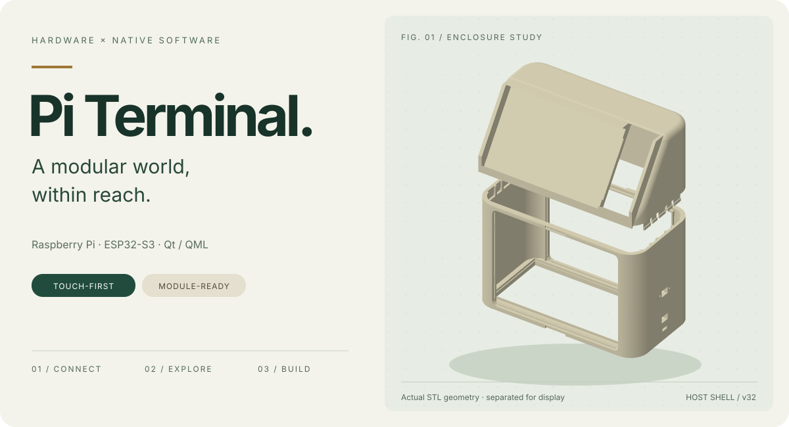
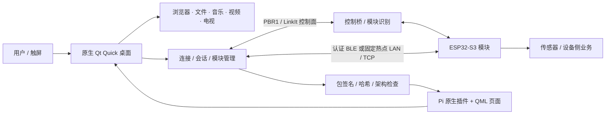
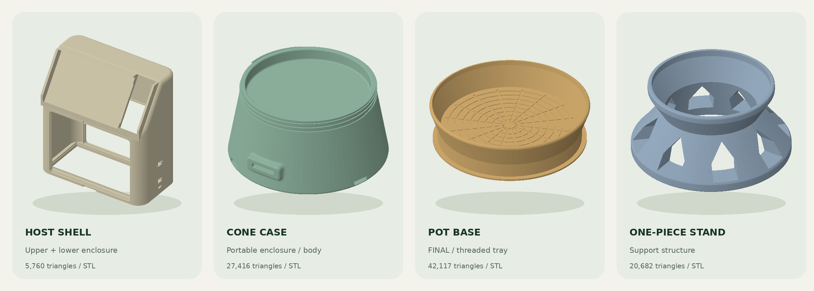

<div align="center">



# Multi-Function ESP32 · Pi Terminal

**一块触屏，一个终端，让不同的硬件模块拥有自己的界面。**

树莓派原生桌面 × ESP32-S3 模块 × 可打印外壳


[认识项目](#认识项目) · [功能与边界](#功能与边界) · [硬件与外壳](#硬件与外壳) · [开始开发](#开始开发) · [项目路线图](#项目路线图)

</div>

---

## 认识项目

**Multi-Function ESP32 · Pi Terminal** 是一个将原生触屏应用、外接硬件模块和 3D 打印结构连接起来的模块化终端项目。

树莓派运行 C++ / Qt Quick 桌面，提供浏览器、文件与媒体等日常应用；ESP32-S3 模块负责设备侧业务与传感器。终端通过控制通道识别模块，再通过认证的数据通道接收数据和模块包，加载对应的原生插件与 QML 页面。

目标不是把所有设备功能都写进一个庞大的主界面，而是让**连接、会话、模块业务与交互各司其职**。目前已有可独立分发的模块 SDK、智能盆栽环境看板示例，以及从主机到支架的外壳设计资料。

<table>
<tr>
<td width="33%" valign="top">

### 01 / 使用

面向触屏的原生 Qt/QML 界面，统一桌面、应用入口、输入法、系统音量与媒体体验。

</td>
<td width="33%" valign="top">

### 02 / 扩展

通过 SDK 构建 ESP 设备业务与 Pi 插件。原生动态库在 Pi 执行，QML 呈现模块自己的界面。

</td>
<td width="33%" valign="top">

### 03 / 制作

查看、修改和打印主机外壳、圆台外壳、花盆底座与一体化支架，让软件落到实体设备上。

</td>
</tr>
</table>

> **项目状态**：仍在开发与实机验证中。以下介绍依据当前主线源码；“已有实现”不代表每台设备都已完成验收。原有路线图的文字与复选框状态完整保留在文末。

## 功能与边界

| 方向 | 当前主线中的实现 | 阅读入口 / 注意事项 |
| :--- | :--- | :--- |
| 原生触屏桌面 | Qt Quick / QML、应用入口、中英文文案、窗口内输入法、启动遮罩 | [界面与回归说明](docs/pi-ui-regression.md)。主要面向 1024×600 触屏；不是 Web 桌面套壳。 |
| 模块接入 | 控制面与数据面分离、认证会话、签名包验证、`QLibrary` 加载 C ABI 插件 | [模块 SDK](module-devkit/README.md)。串口连接成功不等于业务会话就绪。 |
| 基础触屏浏览器 | Qt WebEngine + Viper 核心能力，导航、标签、书签、历史、下载与权限提示 | [浏览器范围](docs/viper-browser-port.md)。不是完整移植 Viper；不提供用户脚本、凭据自动填充等全部上游功能。 |
| 音乐 | 原生音乐服务、在线 API、本地播放、歌词与整曲缓存后的跳转 | [音乐实现](docs/native-music.md)。在线 API 按需拉起；可用性受上游服务及网络影响。 |
| 本地视频与网络电视 | 本地视频使用 Qt Multimedia；电视页面使用 `GstVideoItem` / GStreamer，含频道与线路选择 | [电视内核说明](docs/tv-hls-player-notes.md)。VLC 迁移仍见路线图，不能把开发分支状态当作主线实现。 |
| 文件与系统 | 文件操作、图片预览、文本编辑、受限 USB 存储访问、系统音量及播报时媒体降音 | [系统库与运行时](docs/native-runtime-modules.md)。USB 与音量控制需要相应系统服务。 |
| 渲染与个性化 | 双槽背景模糊缓存、普通/节能模式；默认关闭的桌宠彩蛋 | [模糊设计](docs/blur-performance.md) · [桌宠说明](README-Arkpets.md)。桌宠显示为图集动画，不是实时 3D 人物。 |
| 环境模块示例 | 温度、空气湿度、气压、照度、电量和日/周温度历史 | [智能盆栽](module-devkit/examples/smart-planter/README.md) · [验证范围](module-devkit/examples/smart-planter/VALIDATION.md)。**没有土壤传感器或浇水执行器**。 |

<details>
<summary><strong>实现与验收不能画等号</strong></summary>

- 电视播放仍有音频卡顿等待优化；第三方频道源可能受地区、运营商或带宽限制，不保证长期可用。
- 音乐、模糊、模块示例的历史测试记录只对应各自记录中的构建和设备，不意味着当前完整测试全绿。
- 电池电量计不能替代 USB/外部供电检测；无可靠检测接线时，供电来源应保持 unknown。软件深睡眠也不等于物理断电。
- HTTPS 数据面、桥板电量管理、双触点握手、NFC/RFID 多用户等仍属于原有路线图，不能从现有认证或签名机制推导出它们已经完成。

</details>

## 系统如何连接



### 两条通道，一个明确的会话

- **控制面**负责连接与模块控制，不承载业务数据或插件包载荷。
- **数据面**按模块配置固定为 BLE-only 或 LAN-only，不因为失败就静默切换另一种业务模式。
- **包传输**可以按显式配置选择认证数据通道或短期热点下载；下载路径不改变模块的业务通道。
- **就绪条件**包括身份、认证、协议和 `session_ready`。仅插上设备、打开串口或 TCP，不算完成接入。

### 原生库与外接插件不是一回事

`terminal_system`、`terminal_music`、`terminal_ui` 是随主程序启动的内置共享库，需与主程序同版发布。外接模块则通过稳定 C ABI 和 `QLibrary` 加载；模块动态库在 **Pi** 上执行，ESP 负责设备业务、数据与包提供，不执行 Pi 的 `.so`。

参见 [源码地图](docs/project-code-map.md)、[运行时模块](docs/native-runtime-modules.md) 与 [SDK 开发指南](module-devkit/docs/AI-CODING-GUIDE.md)。

## 硬件与外壳



*上图由仓库中的真实 STL 网格生成，不是产品实拍。主机仅展示上、下壳，圆台仅展示主体；封面将主机上下壳沿竖直方向分开以便观察，不代表真实装配间距。*

| 组件 | 用途 | 文件入口 |
| :--- | :--- | :--- |
| **Host shell** | 桌面主机上下壳、面板、背板、底盖与走线槽盖；含下壳 A/B 分段及打印拼盘 | [主机模型](hardware/enclosure/host-shell/) |
| **Cone case** | 便携终端圆台主体与盖件 | [圆台模型](hardware/enclosure/cone-case/) |
| **Pot base** | 花盆托盘/底座，保留原版、螺纹最终版与临时定位版本 | [底座模型](hardware/enclosure/pot-base/) |
| **One-piece stand** | 一体化支撑结构 | [支架模型](hardware/enclosure/stand/) |

提供 **Blender · FreeCAD · STEP · STL · 3MF** 多种资料，另附 17 份打印、装配和设计验证文档。不同格式可能对应不同设计阶段，不应假设所有导出件都与原生模型完全等价。

**从这里开始：** [CAD 总览与规格](hardware/enclosure/README.md) · [逐文件说明](docs/enclosure-cad-merge.md) · [装配与打印资料](hardware/enclosure/docs/)

> `host-shell/freecad/Host_Shell.FCStd` 当前 Git 内容为 **LFS 指针**，并非完整 FreeCAD 工程。若未取得对应 LFS 对象，请使用现有 STEP/STL 查看，不要将指针重命名或当作可打开的模型。文件扩展名和历史 README 不能替代文件内容检查。

### 交互式 3D 模型浏览

附带一个无需 CDN 或前端构建的 [WebGL 模型浏览页](docs/showcase/index.html)，直接读取本仓库 STL，支持旋转、缩放、模型切换和主机上下壳分离展示。**GitHub README 不执行 JavaScript，点击 HTML 源文件不会直接运行预览**；克隆后在仓库根目录执行：

```sh
python3 -m http.server 8000 --bind 127.0.0.1
# 浏览器打开 http://127.0.0.1:8000/docs/showcase/
```

无 WebGL 时显示静态模型图。预览用于浏览几何，不替代网格修复、配合检查或打印验收。

## 仓库导航

```text
.
├── pi_terminal/       C++ / Qt Quick 主程序、原生库、QML、媒体与测试
├── module-devkit/     可独立使用的模块 SDK、模板与智能盆栽完整示例
├── hardware/
│   └── enclosure/    外壳 CAD、STL / STEP / 3MF、打印和装配资料
├── build_scripts/     主机与设备构建入口
├── docs/              架构、专项实现、验证记录和项目展示
├── tools/             配包、维护、数据生成和文档素材工具
└── third_party/       Viper、媒体参考代码、GStreamer 头文件等第三方内容
```

> 部分旧文档和维护脚本引用 `esp/` 正式固件目录；**当前 GitHub 主线未跟踪该目录**。公开设备侧开发入口是 `module-devkit/sdk/esp32/` 和 `module-devkit/examples/smart-planter/firmware/`，不要把维护者本地存在的工程当作克隆后必定具备的文件。

## 开始开发

### 1. 获取代码

```sh
git clone https://github.com/Axe665/Multi-Function-ESP32-Pi-Terminal.git
cd Multi-Function-ESP32-Pi-Terminal
```

### 2. 原生终端

主机侧使用 **C++17、CMake 3.21+、Qt 6.4+**。Qt 组件包括 Quick/QuickControls2、Widgets、Network、Bluetooth、SerialPort、WebEngine、Multimedia、TextToSpeech、StateMachine 与构建期 ShaderTools；开启测试时还需要 Qt Test。完整组件清单以 [`pi_terminal/CMakeLists.txt`](pi_terminal/CMakeLists.txt) 为准。

Linux 还需准备匹配的 GStreamer 运行库/插件与开发头文件；Qt WebEngine 等依赖不能仅靠安装 Qt Core 满足。现有 `third_party/gst/` 开发入口可用 [`tools/fetch_gst_headers.sh`](tools/fetch_gst_headers.sh) 准备。系统音量使用 `pactl`，可移动存储按需使用 `udisksctl`；在线音乐 API 另需 Node.js 和相应依赖，见 [音乐说明](docs/native-music.md)。

准备好依赖后，使用项目现有构建入口：

```sh
# 可选：指向自己的 Qt 安装，不指定时脚本会尝试默认 SDK 目录
export OPI_QT_ROOT=/path/to/Qt/6.x/gcc_64
bash build_scripts/build_terminal.sh
bash build_scripts/run_terminal.sh
```

这不是一键安装操作系统依赖的脚本。树莓派发布需使用与目标 Qt/系统匹配的 ARM64 工具链交叉编译，并在实机验证；不要把 x86_64 产物复制到 Pi，也不要只更新主程序而遗漏三个同版内置库。历史现场部署信息见 [部署记录](docs/deployment-20261018.md)，其中机器路径不是通用安装要求。

### 3. 编写自己的模块

```sh
cd module-devkit
python3 module_devkit.py doctor
python3 module_devkit.py init /path/to/my-module --module-id 200 --name "我的模块"
python3 ai_guide.py /path/to/my-module --module-id 200 --transport LAN
python3 module_devkit.py validate /path/to/my-module
```

随后按 [SDK README](module-devkit/README.md) 完成 ARM64 主机库构建、资源整理、签名和设备固件构建。示例 ID 不代表设备已获信任；实际身份、token、公钥及传输配置必须符合终端接受范围。不要公开私钥、设备私有配置或包含凭据的固件产物。

### 4. 测试与贡献

```sh
# 已准备所需 Qt / GStreamer / 测试依赖后，在仓库根目录执行
bash build_scripts/test_terminal.sh
```

专项入口见 [界面回归](docs/pi-ui-regression.md)、[模糊性能](docs/blur-performance.md) 和 [模块实机验收清单](module-devkit/docs/PHYSICAL-PI-TEST.md)。离屏测试、编译通过、历史截图和真实触摸/音频/握手验收是不同层次的证据。本次 README 与展示素材不宣称重新完成这些产品测试。

**贡献原则：** 最小化改动、功能独立成文件、不污染 Main；涉及设备功能须经过匹配环境交叉编译、树莓派实机验证及代码审查，再通过 Pull Request 合入。不要提交私有 profile、密钥、Flash 备份或本机缓存。

## 深入阅读

| 想了解什么 | 从哪里开始 |
| :--- | :--- |
| 全部代码结构与入口 | [源码地图](docs/project-code-map.md) |
| 原生共享库与安装边界 | [运行时设计](docs/native-runtime-modules.md) |
| 模块开发、签名与物理验收 | [SDK](module-devkit/README.md) · [AI 开发指南](module-devkit/docs/AI-CODING-GUIDE.md) |
| 真实环境模块与测试边界 | [智能盆栽示例](module-devkit/examples/smart-planter/README.md) · [验证记录](module-devkit/examples/smart-planter/VALIDATION.md) |
| 外壳文件、打印与装配 | [CAD 总览](hardware/enclosure/README.md) · [文件说明](docs/enclosure-cad-merge.md) |
| 界面、媒体与浏览器 | [UI 回归](docs/pi-ui-regression.md) · [音乐](docs/native-music.md) · [电视](docs/tv-hls-player-notes.md) · [浏览器](docs/viper-browser-port.md) |
| 桌宠彩蛋 | [使用说明](README-Arkpets.md) · [本地实现](docs/arkpets-local.md) |

文档可能记录特定时刻或本机环境；发生冲突时优先核对当前源代码、目标构建配置与对应版本的验证记录。

## 素材与第三方说明

- 本页封面与模型图基于仓库 STL 生成。视觉采用 [Anatomy](https://github.com/wheresryan22/anatomy) 启发的等距工程陈列风格；展示页与生成器为本项目代码，不依赖 Anatomy 运行时。重建说明见 [展示资源说明](docs/showcase/README.md)。
- Viper-Browser、YesPlayMusic、字体、图标及桌宠素材分别保留自己的授权与来源说明。YesPlayMusic 是参考代码，不是终端的 Electron 播放运行路径。
- [频道源说明](pi_terminal/assets/tv/SOURCE.md) 说明了第三方直播流的来源、网络与使用限制，不代表官方授权分发。
- 当前仓库根目录未提供统一的主项目 LICENSE；不要从第三方目录的许可证推导出主项目代码、CAD 或角色素材可自由商用。使用或再分发前，请核对相应授权并向维护者确认。

---

<a id="项目路线图"></a>

# 项目路线图
## Warning
- [ ] 代码要求做最小化改动 必须交叉编译到树莓派上进行实机验证+代码审查后才会Merge Code
- [ ] 功能做成单独的代码文件 不要污染Main

## 场景与体验

- [ ] 数据安全与隐私保护
- [ ] 适老化体验（New Feature: 在线电视观看功能开发 技术选择自由搭配 目前已完成 有音频卡顿）
- [ ] 面向有限网络环境的延伸场景

## 模块规划

- [ ] 安全围栏模块（实现方式待评估）
- [ ] 血压计模块

## 用户与数据

- [ ] 增加 NFC 或 RFID 刷卡切换用户（模块做）
- [ ] 在终端 QML 中封装用户登录流程（SDK示例）
- [ ] 实现多用户使用及用户数据存储（QML）

## 通信与硬件

- [ ] 加密 HTTPS 数据传输（pi终端代码 数据面实现 双端代码都需要改）
- [ ] 桥板电池电量管理（桥板+OS改动）
- [ ] 双触点握手（需要修改pi终端代码+控制面代码改动 需要实机测试）

## 安全更新

- [ ] 评估 OTA 更新方案（软件OTA？ 暂且不做 可以参考模块页面实时增加或销毁）
- [ ] 安全与隐私作为 OTA 设计优先项（加强安全系统设计 软件运行环境SandBoxing 沙箱化 要加强围绕安全和隐私 收紧权限管理 模块连接时验证步骤检查）
- [ ] 联网功能数据安全控制

## bug fixes or improving features
- [ ] 视频播放器 后端从QT Multimedia -> VLC 目前已经完成 并且根据树莓派性能做了测试 还不错？ 需要实机验证
- [ ] 增加一个joystick用来控制网页浏览+适老化功能 还未测试
- [ ] 浏览器界面优化 增大网页显示面积 布局排版优化 + 可见的bug fixes planed 等待上一个计划完成
