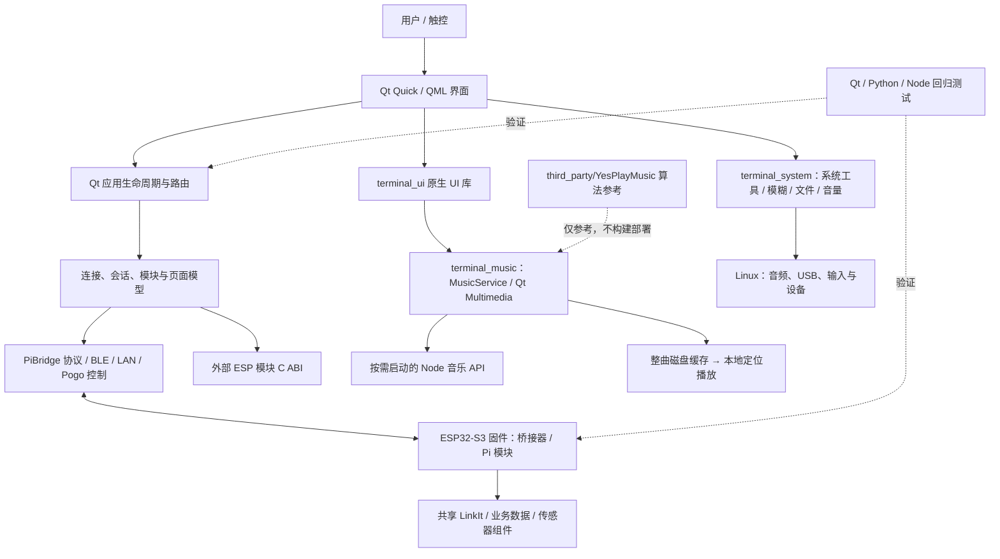
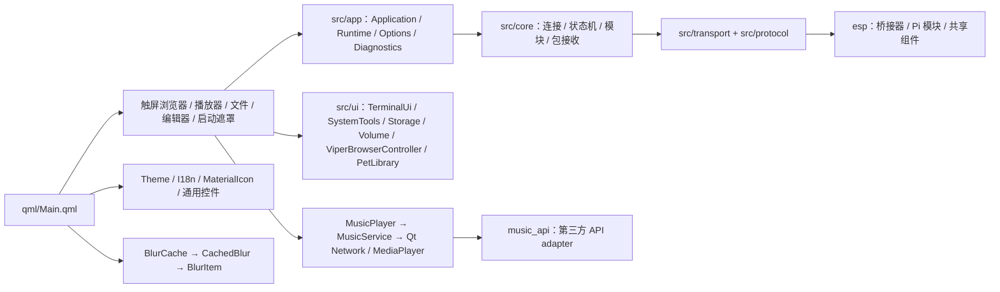

# 项目代码结构图（QML / 源码总览）

> 自动生成。重新盘点并更新本文：`python3 tools/generate_project_code_map.py`。
> 文件清单包含仓库内维护的代码/构建脚本（含 `third_party/YesPlayMusic`），排除 `.git`、`node_modules`、`__pycache__`、构建输出及非代码素材/配置。

## 架构简图



## QML 界面与原生代码关系



## 所有代码文件

共 **340 个**代码/构建脚本文件（不含依赖目录 `node_modules`）。下列清单按仓库目录完整列出：

### `build_scripts/`（7 个）

```text
build_scripts/build_all_esp32.sh
build_scripts/build_esp32.sh
build_scripts/build_pi_module.sh
build_scripts/build_pi_module_variant.sh
build_scripts/build_terminal.sh
build_scripts/run_terminal.sh
build_scripts/test_terminal.sh
```

### `docs/`（1 个）

```text
docs/build_technical_word.py
```

### `esp/`（99 个）

```text
esp/S3_PiBridge_LinkIt_Host/CMakeLists.txt
esp/S3_PiBridge_LinkIt_Host/components/board_pins/CMakeLists.txt
esp/S3_PiBridge_LinkIt_Host/components/board_pins/include/board_pins.h
esp/S3_PiBridge_LinkIt_Host/components/board_pins/include/linkit_pins.h
esp/S3_PiBridge_LinkIt_Host/components/diagnostics/CMakeLists.txt
esp/S3_PiBridge_LinkIt_Host/components/diagnostics/diagnostics.c
esp/S3_PiBridge_LinkIt_Host/components/diagnostics/include/diagnostics.h
esp/S3_PiBridge_LinkIt_Host/components/linkit_sdk/CMakeLists.txt
esp/S3_PiBridge_LinkIt_Host/components/linkit_sdk/include/board_config.h
esp/S3_PiBridge_LinkIt_Host/components/linkit_sdk/include/linkit.h
esp/S3_PiBridge_LinkIt_Host/components/linkit_sdk/include/linkit_common.h
esp/S3_PiBridge_LinkIt_Host/components/linkit_sdk/include/linkit_config.h
esp/S3_PiBridge_LinkIt_Host/components/linkit_sdk/include/linkit_crc16.h
esp/S3_PiBridge_LinkIt_Host/components/linkit_sdk/include/linkit_det.h
esp/S3_PiBridge_LinkIt_Host/components/linkit_sdk/include/linkit_device.h
esp/S3_PiBridge_LinkIt_Host/components/linkit_sdk/include/linkit_err.h
esp/S3_PiBridge_LinkIt_Host/components/linkit_sdk/include/linkit_frame.h
esp/S3_PiBridge_LinkIt_Host/components/linkit_sdk/include/linkit_handshake.h
esp/S3_PiBridge_LinkIt_Host/components/linkit_sdk/include/linkit_host.h
esp/S3_PiBridge_LinkIt_Host/components/linkit_sdk/include/linkit_parser.h
esp/S3_PiBridge_LinkIt_Host/components/linkit_sdk/include/linkit_protocol.h
esp/S3_PiBridge_LinkIt_Host/components/linkit_sdk/include/linkit_transport.h
esp/S3_PiBridge_LinkIt_Host/components/linkit_sdk/include/linkit_types.h
esp/S3_PiBridge_LinkIt_Host/components/linkit_sdk/src/core/linkit_config.c
esp/S3_PiBridge_LinkIt_Host/components/linkit_sdk/src/core/linkit_core.c
esp/S3_PiBridge_LinkIt_Host/components/linkit_sdk/src/core/linkit_core_internal.h
esp/S3_PiBridge_LinkIt_Host/components/linkit_sdk/src/core/linkit_crc16.c
esp/S3_PiBridge_LinkIt_Host/components/linkit_sdk/src/core/linkit_frame.c
esp/S3_PiBridge_LinkIt_Host/components/linkit_sdk/src/core/linkit_handshake.c
esp/S3_PiBridge_LinkIt_Host/components/linkit_sdk/src/core/linkit_parser.c
esp/S3_PiBridge_LinkIt_Host/components/linkit_sdk/src/core/linkit_state.c
esp/S3_PiBridge_LinkIt_Host/components/linkit_sdk/src/hal/linkit_hal_board.c
esp/S3_PiBridge_LinkIt_Host/components/linkit_sdk/src/hal/linkit_hal_gpio.c
esp/S3_PiBridge_LinkIt_Host/components/linkit_sdk/src/hal/linkit_hal_time.c
esp/S3_PiBridge_LinkIt_Host/components/linkit_sdk/src/internal/linkit_hs_internal.h
esp/S3_PiBridge_LinkIt_Host/components/linkit_sdk/src/roles/linkit_role_device.c
esp/S3_PiBridge_LinkIt_Host/components/linkit_sdk/src/roles/linkit_role_host.c
esp/S3_PiBridge_LinkIt_Host/components/linkit_sdk/src/transport/linkit_transport_espnow.c
esp/S3_PiBridge_LinkIt_Host/components/linkit_sdk/src/transport/linkit_transport_i2c.c
esp/S3_PiBridge_LinkIt_Host/components/linkit_sdk/src/transport/linkit_transport_spi.c
esp/S3_PiBridge_LinkIt_Host/components/linkit_sdk/src/transport/linkit_transport_uart.c
esp/S3_PiBridge_LinkIt_Host/main/CMakeLists.txt
esp/S3_PiBridge_LinkIt_Host/main/main.c
esp/S3_Pi_Module/CMakeLists.txt
esp/S3_Pi_Module/components/board_pins/CMakeLists.txt
esp/S3_Pi_Module/components/board_pins/include/board_pins.h
esp/S3_Pi_Module/components/board_pins/include/linkit_pins.h
esp/S3_Pi_Module/components/diagnostics/CMakeLists.txt
esp/S3_Pi_Module/components/diagnostics/diagnostics.c
esp/S3_Pi_Module/components/diagnostics/include/diagnostics.h
esp/S3_Pi_Module/components/linkit_sdk/CMakeLists.txt
esp/S3_Pi_Module/components/linkit_sdk/include/board_config.h
esp/S3_Pi_Module/components/linkit_sdk/include/linkit.h
esp/S3_Pi_Module/components/linkit_sdk/include/linkit_common.h
esp/S3_Pi_Module/components/linkit_sdk/include/linkit_config.h
esp/S3_Pi_Module/components/linkit_sdk/include/linkit_crc16.h
esp/S3_Pi_Module/components/linkit_sdk/include/linkit_det.h
esp/S3_Pi_Module/components/linkit_sdk/include/linkit_device.h
esp/S3_Pi_Module/components/linkit_sdk/include/linkit_err.h
esp/S3_Pi_Module/components/linkit_sdk/include/linkit_frame.h
esp/S3_Pi_Module/components/linkit_sdk/include/linkit_handshake.h
esp/S3_Pi_Module/components/linkit_sdk/include/linkit_host.h
esp/S3_Pi_Module/components/linkit_sdk/include/linkit_parser.h
esp/S3_Pi_Module/components/linkit_sdk/include/linkit_protocol.h
esp/S3_Pi_Module/components/linkit_sdk/include/linkit_transport.h
esp/S3_Pi_Module/components/linkit_sdk/include/linkit_types.h
esp/S3_Pi_Module/components/linkit_sdk/src/core/linkit_config.c
esp/S3_Pi_Module/components/linkit_sdk/src/core/linkit_core.c
esp/S3_Pi_Module/components/linkit_sdk/src/core/linkit_core_internal.h
esp/S3_Pi_Module/components/linkit_sdk/src/core/linkit_crc16.c
esp/S3_Pi_Module/components/linkit_sdk/src/core/linkit_frame.c
esp/S3_Pi_Module/components/linkit_sdk/src/core/linkit_handshake.c
esp/S3_Pi_Module/components/linkit_sdk/src/core/linkit_parser.c
esp/S3_Pi_Module/components/linkit_sdk/src/core/linkit_state.c
esp/S3_Pi_Module/components/linkit_sdk/src/hal/linkit_hal_board.c
esp/S3_Pi_Module/components/linkit_sdk/src/hal/linkit_hal_gpio.c
esp/S3_Pi_Module/components/linkit_sdk/src/hal/linkit_hal_time.c
esp/S3_Pi_Module/components/linkit_sdk/src/internal/linkit_hs_internal.h
esp/S3_Pi_Module/components/linkit_sdk/src/roles/linkit_role_device.c
esp/S3_Pi_Module/components/linkit_sdk/src/roles/linkit_role_host.c
esp/S3_Pi_Module/components/linkit_sdk/src/transport/linkit_transport_espnow.c
esp/S3_Pi_Module/components/linkit_sdk/src/transport/linkit_transport_i2c.c
esp/S3_Pi_Module/components/linkit_sdk/src/transport/linkit_transport_spi.c
esp/S3_Pi_Module/components/linkit_sdk/src/transport/linkit_transport_uart.c
esp/S3_Pi_Module/main/CMakeLists.txt
esp/S3_Pi_Module/main/main.c
esp/shared/module_data_service/CMakeLists.txt
esp/shared/module_data_service/include/module_data_ble.h
esp/shared/module_data_service/include/module_data_ble_gatt.h
esp/shared/module_data_service/include/module_data_service.h
esp/shared/module_data_service/module_data_ble.c
esp/shared/module_data_service/module_data_ble_gatt.c
esp/shared/module_data_service/module_data_http_package.c
esp/shared/module_data_service/module_data_package.c
esp/shared/module_data_service/module_data_service.c
esp/shared/module_data_service/module_data_wifi.c
esp/shared/pi_sensor_device/CMakeLists.txt
esp/shared/pi_sensor_device/include/pi_sensor_device.h
esp/shared/pi_sensor_device/pi_sensor_device.c
```

### `pi_terminal/`（130 个）

```text
pi_terminal/CMakeLists.txt
pi_terminal/cmake/OrangePiModuleSDKConfig.cmake
pi_terminal/modules/example/CMakeLists.txt
pi_terminal/modules/example/example_module.cpp
pi_terminal/modules/example/qml/DiagnosticsPage.qml
pi_terminal/modules/example/qml/ExamplePage.qml
pi_terminal/modules/example/qml/MetricCard.qml
pi_terminal/modules/test_devices/CMakeLists.txt
pi_terminal/modules/test_devices/camera.qml
pi_terminal/modules/test_devices/counter.qml
pi_terminal/modules/test_devices/environment.qml
pi_terminal/music_api/server.cjs
pi_terminal/qml/AppIcon.qml
pi_terminal/qml/AppLauncher.qml
pi_terminal/qml/ApplicationDrawer.qml
pi_terminal/qml/BlurCache.qml
pi_terminal/qml/CachedBlur.qml
pi_terminal/qml/CarButton.qml
pi_terminal/qml/CarField.qml
pi_terminal/qml/CarText.qml
pi_terminal/qml/EditorToolbar.qml
pi_terminal/qml/FileThumbnail.qml
pi_terminal/qml/FloatingKeyboard.qml
pi_terminal/qml/GlassSurface.qml
pi_terminal/qml/I18n.qml
pi_terminal/qml/IconButton.qml
pi_terminal/qml/KeyboardKey.qml
pi_terminal/qml/Main.qml
pi_terminal/qml/MaterialIcon.qml
pi_terminal/qml/MusicModeButton.qml
pi_terminal/qml/MusicPlayer.qml
pi_terminal/qml/MusicText.qml
pi_terminal/qml/PaintToolButton.qml
pi_terminal/qml/PictureViewer.qml
pi_terminal/qml/QuickPanelTile.qml
pi_terminal/qml/QuickToggle.qml
pi_terminal/qml/SettingsGroup.qml
pi_terminal/qml/StartupSplash.qml
pi_terminal/qml/StatusDock.qml
pi_terminal/qml/Theme.qml
pi_terminal/qml/VideoPlayer.qml
pi_terminal/scripts/build.sh
pi_terminal/scripts/check-audio.sh
pi_terminal/scripts/configure-hotspot.sh
pi_terminal/scripts/env.sh
pi_terminal/scripts/install-music-api.sh
pi_terminal/scripts/run-desktop-preview.sh
pi_terminal/scripts/run-desktop.sh
pi_terminal/scripts/setup-desktop.py
pi_terminal/scripts/test.sh
pi_terminal/src/app/DiagnosticRunner.cpp
pi_terminal/src/app/DiagnosticRunner.h
pi_terminal/src/app/TerminalApplication.cpp
pi_terminal/src/app/TerminalApplication.h
pi_terminal/src/app/TerminalOptions.cpp
pi_terminal/src/app/TerminalOptions.h
pi_terminal/src/app/TerminalRuntime.cpp
pi_terminal/src/app/TerminalRuntime.h
pi_terminal/src/core/BridgeConnectionMonitor.h
pi_terminal/src/core/ConnectionManager.cpp
pi_terminal/src/core/ConnectionManager.h
pi_terminal/src/core/HostEventDetector.h
pi_terminal/src/core/ModuleCardModel.cpp
pi_terminal/src/core/ModuleCardModel.h
pi_terminal/src/core/ModuleManager.cpp
pi_terminal/src/core/ModuleManager.h
pi_terminal/src/core/PackageReceiver.cpp
pi_terminal/src/core/PackageReceiver.h
pi_terminal/src/core/PageProvider.cpp
pi_terminal/src/core/PageProvider.h
pi_terminal/src/core/SessionStateMachine.cpp
pi_terminal/src/core/SessionStateMachine.h
pi_terminal/src/core/TransportPolicy.h
pi_terminal/src/main.cpp
pi_terminal/src/modules/api/IModulePlugin.h
pi_terminal/src/modules/api/pi_module_api.h
pi_terminal/src/protocol/data_checksum.h
pi_terminal/src/protocol/pibridge_protocol.cpp
pi_terminal/src/protocol/pibridge_protocol.h
pi_terminal/src/transport/BleTransport.cpp
pi_terminal/src/transport/BleTransport.h
pi_terminal/src/transport/HotspotLanTransport.cpp
pi_terminal/src/transport/HotspotLanTransport.h
pi_terminal/src/transport/PogoControlTransport.cpp
pi_terminal/src/transport/PogoControlTransport.h
pi_terminal/src/transport/TransportBase.h
pi_terminal/src/ui/BlurItem.cpp
pi_terminal/src/ui/BlurItem.h
pi_terminal/src/ui/DesktopShell.cpp
pi_terminal/src/ui/DesktopShell.h
pi_terminal/src/ui/MusicPlayback.cpp
pi_terminal/src/ui/MusicPlayback.h
pi_terminal/src/ui/MusicService.cpp
pi_terminal/src/ui/MusicService.h
pi_terminal/src/ui/RemovableStorage.cpp
pi_terminal/src/ui/RemovableStorage.h
pi_terminal/src/ui/SystemTools.cpp
pi_terminal/src/ui/SystemTools.h
pi_terminal/src/ui/SystemVolume.cpp
pi_terminal/src/ui/SystemVolume.h
pi_terminal/src/ui/TerminalUi.cpp
pi_terminal/src/ui/TerminalUi.h
pi_terminal/src/ui/TextFormatter.h
pi_terminal/tests/GuiAudit.cpp
pi_terminal/tests/GuiAudit.h
pi_terminal/tests/music_playback_test.cpp
pi_terminal/tests/music_queue_test.cjs
pi_terminal/tests/music_seek_test.cpp
pi_terminal/tests/music_service_test.cpp
pi_terminal/tests/plugin_scale_test.cpp
pi_terminal/tests/protocol_test.cpp
pi_terminal/tests/run_integration.py
pi_terminal/tests/runtime_test.cpp
pi_terminal/tests/screenshot_regression.py
pi_terminal/tests/session_test.cpp
pi_terminal/tests/shared_runtime_install.py
pi_terminal/tests/startup_splash_test.cpp
pi_terminal/tests/text_formatter_test.cpp
pi_terminal/tools/build_pinyin_dictionary.py
pi_terminal/tools/build_word.py
pi_terminal/tools/compare_render_metrics.py
pi_terminal/tools/desktop_demo.py
pi_terminal/tools/fetch_material_icons.py
pi_terminal/tools/localize_ui.py
pi_terminal/tools/mock_bridge.py
pi_terminal/tools/mock_module.py
pi_terminal/tools/mock_pogo_control/CMakeLists.txt
pi_terminal/tools/mock_pogo_control/main.cpp
pi_terminal/tools/package_tool.py
pi_terminal/tools/runtime_bundle.py
```

### `third_party/`（101 个）

```text
third_party/YesPlayMusic/babel.config.js
third_party/YesPlayMusic/install-replit.sh
third_party/YesPlayMusic/public/index.html
third_party/YesPlayMusic/src/App.vue
third_party/YesPlayMusic/src/api/album.js
third_party/YesPlayMusic/src/api/artist.js
third_party/YesPlayMusic/src/api/auth.js
third_party/YesPlayMusic/src/api/lastfm.js
third_party/YesPlayMusic/src/api/mv.js
third_party/YesPlayMusic/src/api/others.js
third_party/YesPlayMusic/src/api/playlist.js
third_party/YesPlayMusic/src/api/track.js
third_party/YesPlayMusic/src/api/user.js
third_party/YesPlayMusic/src/assets/css/nprogress.css
third_party/YesPlayMusic/src/assets/css/plyr.css
third_party/YesPlayMusic/src/assets/css/slider.css
third_party/YesPlayMusic/src/assets/icons/index.js
third_party/YesPlayMusic/src/background.js
third_party/YesPlayMusic/src/components/ArtistsInLine.vue
third_party/YesPlayMusic/src/components/ButtonIcon.vue
third_party/YesPlayMusic/src/components/ButtonTwoTone.vue
third_party/YesPlayMusic/src/components/ContextMenu.vue
third_party/YesPlayMusic/src/components/Cover.vue
third_party/YesPlayMusic/src/components/CoverRow.vue
third_party/YesPlayMusic/src/components/DailyTracksCard.vue
third_party/YesPlayMusic/src/components/ExplicitSymbol.vue
third_party/YesPlayMusic/src/components/FMCard.vue
third_party/YesPlayMusic/src/components/LinuxTitlebar.vue
third_party/YesPlayMusic/src/components/Modal.vue
third_party/YesPlayMusic/src/components/ModalAddTrackToPlaylist.vue
third_party/YesPlayMusic/src/components/ModalNewPlaylist.vue
third_party/YesPlayMusic/src/components/MvRow.vue
third_party/YesPlayMusic/src/components/Navbar.vue
third_party/YesPlayMusic/src/components/Player.vue
third_party/YesPlayMusic/src/components/Scrollbar.vue
third_party/YesPlayMusic/src/components/SvgIcon.vue
third_party/YesPlayMusic/src/components/Toast.vue
third_party/YesPlayMusic/src/components/TrackList.vue
third_party/YesPlayMusic/src/components/TrackListItem.vue
third_party/YesPlayMusic/src/components/Win32Titlebar.vue
third_party/YesPlayMusic/src/electron/dockMenu.js
third_party/YesPlayMusic/src/electron/globalShortcut.js
third_party/YesPlayMusic/src/electron/ipcMain.js
third_party/YesPlayMusic/src/electron/ipcRenderer.js
third_party/YesPlayMusic/src/electron/menu.js
third_party/YesPlayMusic/src/electron/mpris.js
third_party/YesPlayMusic/src/electron/scrobble.js
third_party/YesPlayMusic/src/electron/services.js
third_party/YesPlayMusic/src/electron/touchBar.js
third_party/YesPlayMusic/src/electron/tray.js
third_party/YesPlayMusic/src/locale/index.js
third_party/YesPlayMusic/src/locale/lang/en.js
third_party/YesPlayMusic/src/locale/lang/tr.js
third_party/YesPlayMusic/src/locale/lang/zh-CN.js
third_party/YesPlayMusic/src/locale/lang/zh-TW.js
third_party/YesPlayMusic/src/main.js
third_party/YesPlayMusic/src/ncmModDef.js
third_party/YesPlayMusic/src/registerServiceWorker.js
third_party/YesPlayMusic/src/router/index.js
third_party/YesPlayMusic/src/store/actions.js
third_party/YesPlayMusic/src/store/index.js
third_party/YesPlayMusic/src/store/initLocalStorage.js
third_party/YesPlayMusic/src/store/mutations.js
third_party/YesPlayMusic/src/store/plugins/localStorage.js
third_party/YesPlayMusic/src/store/plugins/sendSettings.js
third_party/YesPlayMusic/src/store/state.js
third_party/YesPlayMusic/src/utils/Player.js
third_party/YesPlayMusic/src/utils/auth.js
third_party/YesPlayMusic/src/utils/base64.js
third_party/YesPlayMusic/src/utils/checkAuthToken.js
third_party/YesPlayMusic/src/utils/common.js
third_party/YesPlayMusic/src/utils/db.js
third_party/YesPlayMusic/src/utils/filters.js
third_party/YesPlayMusic/src/utils/lyrics.js
third_party/YesPlayMusic/src/utils/nativeAlert.js
third_party/YesPlayMusic/src/utils/platform.js
third_party/YesPlayMusic/src/utils/playList.js
third_party/YesPlayMusic/src/utils/request.js
third_party/YesPlayMusic/src/utils/shortcuts.js
third_party/YesPlayMusic/src/utils/staticData.js
third_party/YesPlayMusic/src/utils/updateApp.js
third_party/YesPlayMusic/src/views/album.vue
third_party/YesPlayMusic/src/views/artist.vue
third_party/YesPlayMusic/src/views/artistMV.vue
third_party/YesPlayMusic/src/views/dailyTracks.vue
third_party/YesPlayMusic/src/views/explore.vue
third_party/YesPlayMusic/src/views/home.vue
third_party/YesPlayMusic/src/views/lastfmCallback.vue
third_party/YesPlayMusic/src/views/library.vue
third_party/YesPlayMusic/src/views/login.vue
third_party/YesPlayMusic/src/views/loginAccount.vue
third_party/YesPlayMusic/src/views/loginUsername.vue
third_party/YesPlayMusic/src/views/lyrics.vue
third_party/YesPlayMusic/src/views/mv.vue
third_party/YesPlayMusic/src/views/newAlbum.vue
third_party/YesPlayMusic/src/views/next.vue
third_party/YesPlayMusic/src/views/playlist.vue
third_party/YesPlayMusic/src/views/search.vue
third_party/YesPlayMusic/src/views/searchType.vue
third_party/YesPlayMusic/src/views/settings.vue
third_party/YesPlayMusic/vue.config.js
```

### `tools/`（2 个）

```text
tools/generate_project_code_map.py
tools/pibridge_serial_smoke.py
```
