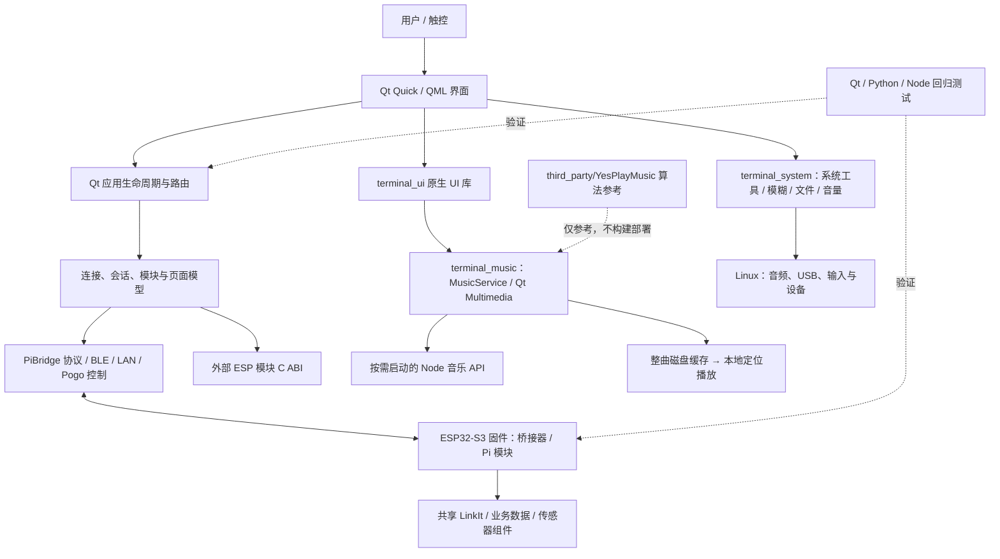
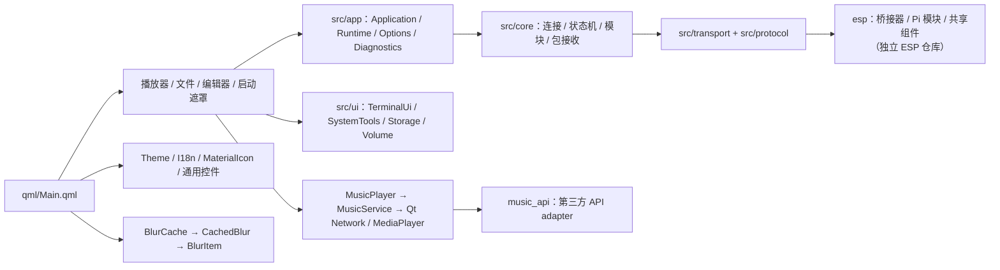

# 项目代码结构图（QML / 源码总览）

> 自动生成。重新盘点并更新本文：`python3 tools/generate_project_code_map.py`。
> 文件清单包含仓库内维护的代码/构建脚本，排除 `.git`、`node_modules`、`__pycache__`、构建输出及非代码素材/配置。
> `third_party/` 按子目录汇总；其余目录逐文件列出。
> **ESP32 固件（`esp/`）不在本仓库**，位于独立仓库 `gggitj/ESP-Modular-Terminal-Service`；本文只在维护者本地并存时才会列出该目录。

## 架构简图



## QML 界面与原生代码关系



## 所有代码文件

共 **1736 个**代码/构建脚本文件（不含依赖目录 `node_modules`）。下列清单按仓库目录列出，`third_party/` 按子目录汇总：

### `build_scripts/`（7 个）

```text
build_scripts/build_all_esp32.sh
build_scripts/build_esp32.sh
build_scripts/build_pi_module.sh
build_scripts/build_pi_module_variant.sh
build_scripts/build_terminal.sh
build_scripts/run_terminal.sh
build_scripts/test_terminal.sh
```

### `docs/`（6 个）

```text
docs/build_technical_word.py
docs/devdocs/team-work-dependency-diagram.html
docs/pbr-secure-v1/gen_vectors.py
docs/pbr-secure-v1/mbedtls_check.c
docs/showcase/connection.html
docs/showcase/index.html
```

### `hardware/`（4 个）

```text
hardware/enclosure/scripts/build_v32.py
hardware/enclosure/scripts/make_print_files.py
hardware/enclosure/scripts/pack_v32.py
hardware/enclosure/scripts/rebuild_v32.py
```

### `module-devkit/`（460 个）

```text
module-devkit/ai_guide.py
module-devkit/examples/smart-planter/CMakeLists.txt
module-devkit/examples/smart-planter/History.h
module-devkit/examples/smart-planter/firmware/CMakeLists.txt
module-devkit/examples/smart-planter/firmware/components/lcd_st7789/CMakeLists.txt
module-devkit/examples/smart-planter/firmware/components/lcd_st7789/include/lcd_rgb565.h
module-devkit/examples/smart-planter/firmware/components/lcd_st7789/include/lcd_st7789.h
module-devkit/examples/smart-planter/firmware/components/lcd_st7789/lcd_st7789.c
module-devkit/examples/smart-planter/firmware/components/lvgl/CMakeLists.txt
module-devkit/examples/smart-planter/firmware/components/lvgl/lv_conf_template.h
module-devkit/examples/smart-planter/firmware/components/lvgl/lvgl.h
module-devkit/examples/smart-planter/firmware/components/lvgl/src/core/lv_disp.c
module-devkit/examples/smart-planter/firmware/components/lvgl/src/core/lv_disp.h
module-devkit/examples/smart-planter/firmware/components/lvgl/src/core/lv_event.c
module-devkit/examples/smart-planter/firmware/components/lvgl/src/core/lv_event.h
module-devkit/examples/smart-planter/firmware/components/lvgl/src/core/lv_group.c
module-devkit/examples/smart-planter/firmware/components/lvgl/src/core/lv_group.h
module-devkit/examples/smart-planter/firmware/components/lvgl/src/core/lv_indev.c
module-devkit/examples/smart-planter/firmware/components/lvgl/src/core/lv_indev.h
module-devkit/examples/smart-planter/firmware/components/lvgl/src/core/lv_indev_scroll.c
module-devkit/examples/smart-planter/firmware/components/lvgl/src/core/lv_indev_scroll.h
module-devkit/examples/smart-planter/firmware/components/lvgl/src/core/lv_obj.c
module-devkit/examples/smart-planter/firmware/components/lvgl/src/core/lv_obj.h
module-devkit/examples/smart-planter/firmware/components/lvgl/src/core/lv_obj_class.c
module-devkit/examples/smart-planter/firmware/components/lvgl/src/core/lv_obj_class.h
module-devkit/examples/smart-planter/firmware/components/lvgl/src/core/lv_obj_draw.c
module-devkit/examples/smart-planter/firmware/components/lvgl/src/core/lv_obj_draw.h
module-devkit/examples/smart-planter/firmware/components/lvgl/src/core/lv_obj_pos.c
module-devkit/examples/smart-planter/firmware/components/lvgl/src/core/lv_obj_pos.h
module-devkit/examples/smart-planter/firmware/components/lvgl/src/core/lv_obj_scroll.c
module-devkit/examples/smart-planter/firmware/components/lvgl/src/core/lv_obj_scroll.h
module-devkit/examples/smart-planter/firmware/components/lvgl/src/core/lv_obj_style.c
module-devkit/examples/smart-planter/firmware/components/lvgl/src/core/lv_obj_style.h
module-devkit/examples/smart-planter/firmware/components/lvgl/src/core/lv_obj_style_gen.c
module-devkit/examples/smart-planter/firmware/components/lvgl/src/core/lv_obj_style_gen.h
module-devkit/examples/smart-planter/firmware/components/lvgl/src/core/lv_obj_tree.c
module-devkit/examples/smart-planter/firmware/components/lvgl/src/core/lv_obj_tree.h
module-devkit/examples/smart-planter/firmware/components/lvgl/src/core/lv_refr.c
module-devkit/examples/smart-planter/firmware/components/lvgl/src/core/lv_refr.h
module-devkit/examples/smart-planter/firmware/components/lvgl/src/core/lv_theme.c
module-devkit/examples/smart-planter/firmware/components/lvgl/src/core/lv_theme.h
module-devkit/examples/smart-planter/firmware/components/lvgl/src/draw/arm2d/lv_gpu_arm2d.c
module-devkit/examples/smart-planter/firmware/components/lvgl/src/draw/arm2d/lv_gpu_arm2d.h
module-devkit/examples/smart-planter/firmware/components/lvgl/src/draw/lv_draw.c
module-devkit/examples/smart-planter/firmware/components/lvgl/src/draw/lv_draw.h
module-devkit/examples/smart-planter/firmware/components/lvgl/src/draw/lv_draw_arc.c
module-devkit/examples/smart-planter/firmware/components/lvgl/src/draw/lv_draw_arc.h
module-devkit/examples/smart-planter/firmware/components/lvgl/src/draw/lv_draw_img.c
module-devkit/examples/smart-planter/firmware/components/lvgl/src/draw/lv_draw_img.h
module-devkit/examples/smart-planter/firmware/components/lvgl/src/draw/lv_draw_label.c
module-devkit/examples/smart-planter/firmware/components/lvgl/src/draw/lv_draw_label.h
module-devkit/examples/smart-planter/firmware/components/lvgl/src/draw/lv_draw_layer.c
module-devkit/examples/smart-planter/firmware/components/lvgl/src/draw/lv_draw_layer.h
module-devkit/examples/smart-planter/firmware/components/lvgl/src/draw/lv_draw_line.c
module-devkit/examples/smart-planter/firmware/components/lvgl/src/draw/lv_draw_line.h
module-devkit/examples/smart-planter/firmware/components/lvgl/src/draw/lv_draw_mask.c
module-devkit/examples/smart-planter/firmware/components/lvgl/src/draw/lv_draw_mask.h
module-devkit/examples/smart-planter/firmware/components/lvgl/src/draw/lv_draw_rect.c
module-devkit/examples/smart-planter/firmware/components/lvgl/src/draw/lv_draw_rect.h
module-devkit/examples/smart-planter/firmware/components/lvgl/src/draw/lv_draw_transform.c
module-devkit/examples/smart-planter/firmware/components/lvgl/src/draw/lv_draw_transform.h
module-devkit/examples/smart-planter/firmware/components/lvgl/src/draw/lv_draw_triangle.c
module-devkit/examples/smart-planter/firmware/components/lvgl/src/draw/lv_draw_triangle.h
module-devkit/examples/smart-planter/firmware/components/lvgl/src/draw/lv_img_buf.c
module-devkit/examples/smart-planter/firmware/components/lvgl/src/draw/lv_img_buf.h
module-devkit/examples/smart-planter/firmware/components/lvgl/src/draw/lv_img_cache.c
module-devkit/examples/smart-planter/firmware/components/lvgl/src/draw/lv_img_cache.h
module-devkit/examples/smart-planter/firmware/components/lvgl/src/draw/lv_img_decoder.c
module-devkit/examples/smart-planter/firmware/components/lvgl/src/draw/lv_img_decoder.h
module-devkit/examples/smart-planter/firmware/components/lvgl/src/draw/nxp/pxp/lv_draw_pxp.c
module-devkit/examples/smart-planter/firmware/components/lvgl/src/draw/nxp/pxp/lv_draw_pxp.h
module-devkit/examples/smart-planter/firmware/components/lvgl/src/draw/nxp/pxp/lv_draw_pxp_blend.c
module-devkit/examples/smart-planter/firmware/components/lvgl/src/draw/nxp/pxp/lv_draw_pxp_blend.h
module-devkit/examples/smart-planter/firmware/components/lvgl/src/draw/nxp/pxp/lv_gpu_nxp_pxp.c
module-devkit/examples/smart-planter/firmware/components/lvgl/src/draw/nxp/pxp/lv_gpu_nxp_pxp.h
module-devkit/examples/smart-planter/firmware/components/lvgl/src/draw/nxp/pxp/lv_gpu_nxp_pxp_osa.c
module-devkit/examples/smart-planter/firmware/components/lvgl/src/draw/nxp/pxp/lv_gpu_nxp_pxp_osa.h
module-devkit/examples/smart-planter/firmware/components/lvgl/src/draw/nxp/vglite/lv_draw_vglite.c
module-devkit/examples/smart-planter/firmware/components/lvgl/src/draw/nxp/vglite/lv_draw_vglite.h
module-devkit/examples/smart-planter/firmware/components/lvgl/src/draw/nxp/vglite/lv_draw_vglite_arc.c
module-devkit/examples/smart-planter/firmware/components/lvgl/src/draw/nxp/vglite/lv_draw_vglite_arc.h
module-devkit/examples/smart-planter/firmware/components/lvgl/src/draw/nxp/vglite/lv_draw_vglite_blend.c
module-devkit/examples/smart-planter/firmware/components/lvgl/src/draw/nxp/vglite/lv_draw_vglite_blend.h
module-devkit/examples/smart-planter/firmware/components/lvgl/src/draw/nxp/vglite/lv_draw_vglite_line.c
module-devkit/examples/smart-planter/firmware/components/lvgl/src/draw/nxp/vglite/lv_draw_vglite_line.h
module-devkit/examples/smart-planter/firmware/components/lvgl/src/draw/nxp/vglite/lv_draw_vglite_rect.c
module-devkit/examples/smart-planter/firmware/components/lvgl/src/draw/nxp/vglite/lv_draw_vglite_rect.h
module-devkit/examples/smart-planter/firmware/components/lvgl/src/draw/nxp/vglite/lv_vglite_buf.c
module-devkit/examples/smart-planter/firmware/components/lvgl/src/draw/nxp/vglite/lv_vglite_buf.h
module-devkit/examples/smart-planter/firmware/components/lvgl/src/draw/nxp/vglite/lv_vglite_utils.c
module-devkit/examples/smart-planter/firmware/components/lvgl/src/draw/nxp/vglite/lv_vglite_utils.h
module-devkit/examples/smart-planter/firmware/components/lvgl/src/draw/renesas/lv_gpu_d2_draw_label.c
module-devkit/examples/smart-planter/firmware/components/lvgl/src/draw/renesas/lv_gpu_d2_ra6m3.c
module-devkit/examples/smart-planter/firmware/components/lvgl/src/draw/renesas/lv_gpu_d2_ra6m3.h
module-devkit/examples/smart-planter/firmware/components/lvgl/src/draw/sdl/lv_draw_sdl.c
module-devkit/examples/smart-planter/firmware/components/lvgl/src/draw/sdl/lv_draw_sdl.h
module-devkit/examples/smart-planter/firmware/components/lvgl/src/draw/sdl/lv_draw_sdl_arc.c
module-devkit/examples/smart-planter/firmware/components/lvgl/src/draw/sdl/lv_draw_sdl_bg.c
module-devkit/examples/smart-planter/firmware/components/lvgl/src/draw/sdl/lv_draw_sdl_composite.c
module-devkit/examples/smart-planter/firmware/components/lvgl/src/draw/sdl/lv_draw_sdl_composite.h
module-devkit/examples/smart-planter/firmware/components/lvgl/src/draw/sdl/lv_draw_sdl_img.c
module-devkit/examples/smart-planter/firmware/components/lvgl/src/draw/sdl/lv_draw_sdl_img.h
module-devkit/examples/smart-planter/firmware/components/lvgl/src/draw/sdl/lv_draw_sdl_label.c
module-devkit/examples/smart-planter/firmware/components/lvgl/src/draw/sdl/lv_draw_sdl_layer.c
module-devkit/examples/smart-planter/firmware/components/lvgl/src/draw/sdl/lv_draw_sdl_layer.h
module-devkit/examples/smart-planter/firmware/components/lvgl/src/draw/sdl/lv_draw_sdl_line.c
module-devkit/examples/smart-planter/firmware/components/lvgl/src/draw/sdl/lv_draw_sdl_mask.c
module-devkit/examples/smart-planter/firmware/components/lvgl/src/draw/sdl/lv_draw_sdl_mask.h
module-devkit/examples/smart-planter/firmware/components/lvgl/src/draw/sdl/lv_draw_sdl_polygon.c
module-devkit/examples/smart-planter/firmware/components/lvgl/src/draw/sdl/lv_draw_sdl_priv.h
module-devkit/examples/smart-planter/firmware/components/lvgl/src/draw/sdl/lv_draw_sdl_rect.c
module-devkit/examples/smart-planter/firmware/components/lvgl/src/draw/sdl/lv_draw_sdl_rect.h
module-devkit/examples/smart-planter/firmware/components/lvgl/src/draw/sdl/lv_draw_sdl_stack_blur.c
module-devkit/examples/smart-planter/firmware/components/lvgl/src/draw/sdl/lv_draw_sdl_stack_blur.h
module-devkit/examples/smart-planter/firmware/components/lvgl/src/draw/sdl/lv_draw_sdl_texture_cache.c
module-devkit/examples/smart-planter/firmware/components/lvgl/src/draw/sdl/lv_draw_sdl_texture_cache.h
module-devkit/examples/smart-planter/firmware/components/lvgl/src/draw/sdl/lv_draw_sdl_utils.c
module-devkit/examples/smart-planter/firmware/components/lvgl/src/draw/sdl/lv_draw_sdl_utils.h
module-devkit/examples/smart-planter/firmware/components/lvgl/src/draw/stm32_dma2d/lv_gpu_stm32_dma2d.c
module-devkit/examples/smart-planter/firmware/components/lvgl/src/draw/stm32_dma2d/lv_gpu_stm32_dma2d.h
module-devkit/examples/smart-planter/firmware/components/lvgl/src/draw/sw/lv_draw_sw.c
module-devkit/examples/smart-planter/firmware/components/lvgl/src/draw/sw/lv_draw_sw.h
module-devkit/examples/smart-planter/firmware/components/lvgl/src/draw/sw/lv_draw_sw_arc.c
module-devkit/examples/smart-planter/firmware/components/lvgl/src/draw/sw/lv_draw_sw_blend.c
module-devkit/examples/smart-planter/firmware/components/lvgl/src/draw/sw/lv_draw_sw_blend.h
module-devkit/examples/smart-planter/firmware/components/lvgl/src/draw/sw/lv_draw_sw_dither.c
module-devkit/examples/smart-planter/firmware/components/lvgl/src/draw/sw/lv_draw_sw_dither.h
module-devkit/examples/smart-planter/firmware/components/lvgl/src/draw/sw/lv_draw_sw_gradient.c
module-devkit/examples/smart-planter/firmware/components/lvgl/src/draw/sw/lv_draw_sw_gradient.h
module-devkit/examples/smart-planter/firmware/components/lvgl/src/draw/sw/lv_draw_sw_img.c
module-devkit/examples/smart-planter/firmware/components/lvgl/src/draw/sw/lv_draw_sw_layer.c
module-devkit/examples/smart-planter/firmware/components/lvgl/src/draw/sw/lv_draw_sw_letter.c
module-devkit/examples/smart-planter/firmware/components/lvgl/src/draw/sw/lv_draw_sw_line.c
module-devkit/examples/smart-planter/firmware/components/lvgl/src/draw/sw/lv_draw_sw_polygon.c
module-devkit/examples/smart-planter/firmware/components/lvgl/src/draw/sw/lv_draw_sw_rect.c
module-devkit/examples/smart-planter/firmware/components/lvgl/src/draw/sw/lv_draw_sw_transform.c
module-devkit/examples/smart-planter/firmware/components/lvgl/src/draw/swm341_dma2d/lv_gpu_swm341_dma2d.c
module-devkit/examples/smart-planter/firmware/components/lvgl/src/draw/swm341_dma2d/lv_gpu_swm341_dma2d.h
module-devkit/examples/smart-planter/firmware/components/lvgl/src/extra/layouts/flex/lv_flex.c
module-devkit/examples/smart-planter/firmware/components/lvgl/src/extra/layouts/flex/lv_flex.h
module-devkit/examples/smart-planter/firmware/components/lvgl/src/extra/layouts/grid/lv_grid.c
module-devkit/examples/smart-planter/firmware/components/lvgl/src/extra/layouts/grid/lv_grid.h
module-devkit/examples/smart-planter/firmware/components/lvgl/src/extra/layouts/lv_layouts.h
module-devkit/examples/smart-planter/firmware/components/lvgl/src/extra/libs/bmp/lv_bmp.c
module-devkit/examples/smart-planter/firmware/components/lvgl/src/extra/libs/bmp/lv_bmp.h
module-devkit/examples/smart-planter/firmware/components/lvgl/src/extra/libs/ffmpeg/lv_ffmpeg.c
module-devkit/examples/smart-planter/firmware/components/lvgl/src/extra/libs/ffmpeg/lv_ffmpeg.h
module-devkit/examples/smart-planter/firmware/components/lvgl/src/extra/libs/freetype/lv_freetype.c
module-devkit/examples/smart-planter/firmware/components/lvgl/src/extra/libs/freetype/lv_freetype.h
module-devkit/examples/smart-planter/firmware/components/lvgl/src/extra/libs/fsdrv/lv_fs_fatfs.c
module-devkit/examples/smart-planter/firmware/components/lvgl/src/extra/libs/fsdrv/lv_fs_littlefs.c
module-devkit/examples/smart-planter/firmware/components/lvgl/src/extra/libs/fsdrv/lv_fs_posix.c
module-devkit/examples/smart-planter/firmware/components/lvgl/src/extra/libs/fsdrv/lv_fs_stdio.c
module-devkit/examples/smart-planter/firmware/components/lvgl/src/extra/libs/fsdrv/lv_fs_win32.c
module-devkit/examples/smart-planter/firmware/components/lvgl/src/extra/libs/fsdrv/lv_fsdrv.h
module-devkit/examples/smart-planter/firmware/components/lvgl/src/extra/libs/gif/gifdec.c
module-devkit/examples/smart-planter/firmware/components/lvgl/src/extra/libs/gif/gifdec.h
module-devkit/examples/smart-planter/firmware/components/lvgl/src/extra/libs/gif/lv_gif.c
module-devkit/examples/smart-planter/firmware/components/lvgl/src/extra/libs/gif/lv_gif.h
module-devkit/examples/smart-planter/firmware/components/lvgl/src/extra/libs/lv_libs.h
module-devkit/examples/smart-planter/firmware/components/lvgl/src/extra/libs/png/lodepng.c
module-devkit/examples/smart-planter/firmware/components/lvgl/src/extra/libs/png/lodepng.h
module-devkit/examples/smart-planter/firmware/components/lvgl/src/extra/libs/png/lv_png.c
module-devkit/examples/smart-planter/firmware/components/lvgl/src/extra/libs/png/lv_png.h
module-devkit/examples/smart-planter/firmware/components/lvgl/src/extra/libs/qrcode/lv_qrcode.c
module-devkit/examples/smart-planter/firmware/components/lvgl/src/extra/libs/qrcode/lv_qrcode.h
module-devkit/examples/smart-planter/firmware/components/lvgl/src/extra/libs/qrcode/qrcodegen.c
module-devkit/examples/smart-planter/firmware/components/lvgl/src/extra/libs/qrcode/qrcodegen.h
module-devkit/examples/smart-planter/firmware/components/lvgl/src/extra/libs/rlottie/lv_rlottie.c
module-devkit/examples/smart-planter/firmware/components/lvgl/src/extra/libs/rlottie/lv_rlottie.h
module-devkit/examples/smart-planter/firmware/components/lvgl/src/extra/libs/sjpg/lv_sjpg.c
module-devkit/examples/smart-planter/firmware/components/lvgl/src/extra/libs/sjpg/lv_sjpg.h
module-devkit/examples/smart-planter/firmware/components/lvgl/src/extra/libs/sjpg/tjpgd.c
module-devkit/examples/smart-planter/firmware/components/lvgl/src/extra/libs/sjpg/tjpgd.h
module-devkit/examples/smart-planter/firmware/components/lvgl/src/extra/libs/sjpg/tjpgdcnf.h
module-devkit/examples/smart-planter/firmware/components/lvgl/src/extra/libs/tiny_ttf/lv_tiny_ttf.c
module-devkit/examples/smart-planter/firmware/components/lvgl/src/extra/libs/tiny_ttf/lv_tiny_ttf.h
module-devkit/examples/smart-planter/firmware/components/lvgl/src/extra/libs/tiny_ttf/stb_rect_pack.h
module-devkit/examples/smart-planter/firmware/components/lvgl/src/extra/libs/tiny_ttf/stb_truetype_htcw.h
module-devkit/examples/smart-planter/firmware/components/lvgl/src/extra/lv_extra.c
module-devkit/examples/smart-planter/firmware/components/lvgl/src/extra/lv_extra.h
module-devkit/examples/smart-planter/firmware/components/lvgl/src/extra/others/fragment/lv_fragment.c
module-devkit/examples/smart-planter/firmware/components/lvgl/src/extra/others/fragment/lv_fragment.h
module-devkit/examples/smart-planter/firmware/components/lvgl/src/extra/others/fragment/lv_fragment_manager.c
module-devkit/examples/smart-planter/firmware/components/lvgl/src/extra/others/gridnav/lv_gridnav.c
module-devkit/examples/smart-planter/firmware/components/lvgl/src/extra/others/gridnav/lv_gridnav.h
module-devkit/examples/smart-planter/firmware/components/lvgl/src/extra/others/ime/lv_ime_pinyin.c
module-devkit/examples/smart-planter/firmware/components/lvgl/src/extra/others/ime/lv_ime_pinyin.h
module-devkit/examples/smart-planter/firmware/components/lvgl/src/extra/others/imgfont/lv_imgfont.c
module-devkit/examples/smart-planter/firmware/components/lvgl/src/extra/others/imgfont/lv_imgfont.h
module-devkit/examples/smart-planter/firmware/components/lvgl/src/extra/others/lv_others.h
module-devkit/examples/smart-planter/firmware/components/lvgl/src/extra/others/monkey/lv_monkey.c
module-devkit/examples/smart-planter/firmware/components/lvgl/src/extra/others/monkey/lv_monkey.h
module-devkit/examples/smart-planter/firmware/components/lvgl/src/extra/others/msg/lv_msg.c
module-devkit/examples/smart-planter/firmware/components/lvgl/src/extra/others/msg/lv_msg.h
module-devkit/examples/smart-planter/firmware/components/lvgl/src/extra/others/snapshot/lv_snapshot.c
module-devkit/examples/smart-planter/firmware/components/lvgl/src/extra/others/snapshot/lv_snapshot.h
module-devkit/examples/smart-planter/firmware/components/lvgl/src/extra/themes/basic/lv_theme_basic.c
module-devkit/examples/smart-planter/firmware/components/lvgl/src/extra/themes/basic/lv_theme_basic.h
module-devkit/examples/smart-planter/firmware/components/lvgl/src/extra/themes/default/lv_theme_default.c
module-devkit/examples/smart-planter/firmware/components/lvgl/src/extra/themes/default/lv_theme_default.h
module-devkit/examples/smart-planter/firmware/components/lvgl/src/extra/themes/lv_themes.h
module-devkit/examples/smart-planter/firmware/components/lvgl/src/extra/themes/mono/lv_theme_mono.c
module-devkit/examples/smart-planter/firmware/components/lvgl/src/extra/themes/mono/lv_theme_mono.h
module-devkit/examples/smart-planter/firmware/components/lvgl/src/extra/widgets/animimg/lv_animimg.c
module-devkit/examples/smart-planter/firmware/components/lvgl/src/extra/widgets/animimg/lv_animimg.h
module-devkit/examples/smart-planter/firmware/components/lvgl/src/extra/widgets/calendar/lv_calendar.c
module-devkit/examples/smart-planter/firmware/components/lvgl/src/extra/widgets/calendar/lv_calendar.h
module-devkit/examples/smart-planter/firmware/components/lvgl/src/extra/widgets/calendar/lv_calendar_header_arrow.c
module-devkit/examples/smart-planter/firmware/components/lvgl/src/extra/widgets/calendar/lv_calendar_header_arrow.h
module-devkit/examples/smart-planter/firmware/components/lvgl/src/extra/widgets/calendar/lv_calendar_header_dropdown.c
module-devkit/examples/smart-planter/firmware/components/lvgl/src/extra/widgets/calendar/lv_calendar_header_dropdown.h
module-devkit/examples/smart-planter/firmware/components/lvgl/src/extra/widgets/chart/lv_chart.c
module-devkit/examples/smart-planter/firmware/components/lvgl/src/extra/widgets/chart/lv_chart.h
module-devkit/examples/smart-planter/firmware/components/lvgl/src/extra/widgets/colorwheel/lv_colorwheel.c
module-devkit/examples/smart-planter/firmware/components/lvgl/src/extra/widgets/colorwheel/lv_colorwheel.h
module-devkit/examples/smart-planter/firmware/components/lvgl/src/extra/widgets/imgbtn/lv_imgbtn.c
module-devkit/examples/smart-planter/firmware/components/lvgl/src/extra/widgets/imgbtn/lv_imgbtn.h
module-devkit/examples/smart-planter/firmware/components/lvgl/src/extra/widgets/keyboard/lv_keyboard.c
module-devkit/examples/smart-planter/firmware/components/lvgl/src/extra/widgets/keyboard/lv_keyboard.h
module-devkit/examples/smart-planter/firmware/components/lvgl/src/extra/widgets/led/lv_led.c
module-devkit/examples/smart-planter/firmware/components/lvgl/src/extra/widgets/led/lv_led.h
module-devkit/examples/smart-planter/firmware/components/lvgl/src/extra/widgets/list/lv_list.c
module-devkit/examples/smart-planter/firmware/components/lvgl/src/extra/widgets/list/lv_list.h
module-devkit/examples/smart-planter/firmware/components/lvgl/src/extra/widgets/lv_widgets.h
module-devkit/examples/smart-planter/firmware/components/lvgl/src/extra/widgets/menu/lv_menu.c
module-devkit/examples/smart-planter/firmware/components/lvgl/src/extra/widgets/menu/lv_menu.h
module-devkit/examples/smart-planter/firmware/components/lvgl/src/extra/widgets/meter/lv_meter.c
module-devkit/examples/smart-planter/firmware/components/lvgl/src/extra/widgets/meter/lv_meter.h
module-devkit/examples/smart-planter/firmware/components/lvgl/src/extra/widgets/msgbox/lv_msgbox.c
module-devkit/examples/smart-planter/firmware/components/lvgl/src/extra/widgets/msgbox/lv_msgbox.h
module-devkit/examples/smart-planter/firmware/components/lvgl/src/extra/widgets/span/lv_span.c
module-devkit/examples/smart-planter/firmware/components/lvgl/src/extra/widgets/span/lv_span.h
module-devkit/examples/smart-planter/firmware/components/lvgl/src/extra/widgets/spinbox/lv_spinbox.c
module-devkit/examples/smart-planter/firmware/components/lvgl/src/extra/widgets/spinbox/lv_spinbox.h
module-devkit/examples/smart-planter/firmware/components/lvgl/src/extra/widgets/spinner/lv_spinner.c
module-devkit/examples/smart-planter/firmware/components/lvgl/src/extra/widgets/spinner/lv_spinner.h
module-devkit/examples/smart-planter/firmware/components/lvgl/src/extra/widgets/tabview/lv_tabview.c
module-devkit/examples/smart-planter/firmware/components/lvgl/src/extra/widgets/tabview/lv_tabview.h
module-devkit/examples/smart-planter/firmware/components/lvgl/src/extra/widgets/tileview/lv_tileview.c
module-devkit/examples/smart-planter/firmware/components/lvgl/src/extra/widgets/tileview/lv_tileview.h
module-devkit/examples/smart-planter/firmware/components/lvgl/src/extra/widgets/win/lv_win.c
module-devkit/examples/smart-planter/firmware/components/lvgl/src/extra/widgets/win/lv_win.h
module-devkit/examples/smart-planter/firmware/components/lvgl/src/font/lv_font.c
module-devkit/examples/smart-planter/firmware/components/lvgl/src/font/lv_font.h
module-devkit/examples/smart-planter/firmware/components/lvgl/src/font/lv_font_dejavu_16_persian_hebrew.c
module-devkit/examples/smart-planter/firmware/components/lvgl/src/font/lv_font_fmt_txt.c
module-devkit/examples/smart-planter/firmware/components/lvgl/src/font/lv_font_fmt_txt.h
module-devkit/examples/smart-planter/firmware/components/lvgl/src/font/lv_font_loader.c
module-devkit/examples/smart-planter/firmware/components/lvgl/src/font/lv_font_loader.h
module-devkit/examples/smart-planter/firmware/components/lvgl/src/font/lv_font_montserrat_10.c
module-devkit/examples/smart-planter/firmware/components/lvgl/src/font/lv_font_montserrat_12.c
module-devkit/examples/smart-planter/firmware/components/lvgl/src/font/lv_font_montserrat_12_subpx.c
module-devkit/examples/smart-planter/firmware/components/lvgl/src/font/lv_font_montserrat_14.c
module-devkit/examples/smart-planter/firmware/components/lvgl/src/font/lv_font_montserrat_16.c
module-devkit/examples/smart-planter/firmware/components/lvgl/src/font/lv_font_montserrat_18.c
module-devkit/examples/smart-planter/firmware/components/lvgl/src/font/lv_font_montserrat_20.c
module-devkit/examples/smart-planter/firmware/components/lvgl/src/font/lv_font_montserrat_22.c
module-devkit/examples/smart-planter/firmware/components/lvgl/src/font/lv_font_montserrat_24.c
module-devkit/examples/smart-planter/firmware/components/lvgl/src/font/lv_font_montserrat_26.c
module-devkit/examples/smart-planter/firmware/components/lvgl/src/font/lv_font_montserrat_28.c
module-devkit/examples/smart-planter/firmware/components/lvgl/src/font/lv_font_montserrat_28_compressed.c
module-devkit/examples/smart-planter/firmware/components/lvgl/src/font/lv_font_montserrat_30.c
module-devkit/examples/smart-planter/firmware/components/lvgl/src/font/lv_font_montserrat_32.c
module-devkit/examples/smart-planter/firmware/components/lvgl/src/font/lv_font_montserrat_34.c
module-devkit/examples/smart-planter/firmware/components/lvgl/src/font/lv_font_montserrat_36.c
module-devkit/examples/smart-planter/firmware/components/lvgl/src/font/lv_font_montserrat_38.c
module-devkit/examples/smart-planter/firmware/components/lvgl/src/font/lv_font_montserrat_40.c
module-devkit/examples/smart-planter/firmware/components/lvgl/src/font/lv_font_montserrat_42.c
module-devkit/examples/smart-planter/firmware/components/lvgl/src/font/lv_font_montserrat_44.c
module-devkit/examples/smart-planter/firmware/components/lvgl/src/font/lv_font_montserrat_46.c
module-devkit/examples/smart-planter/firmware/components/lvgl/src/font/lv_font_montserrat_48.c
module-devkit/examples/smart-planter/firmware/components/lvgl/src/font/lv_font_montserrat_8.c
module-devkit/examples/smart-planter/firmware/components/lvgl/src/font/lv_font_simsun_16_cjk.c
module-devkit/examples/smart-planter/firmware/components/lvgl/src/font/lv_font_unscii_16.c
module-devkit/examples/smart-planter/firmware/components/lvgl/src/font/lv_font_unscii_8.c
module-devkit/examples/smart-planter/firmware/components/lvgl/src/font/lv_symbol_def.h
module-devkit/examples/smart-planter/firmware/components/lvgl/src/hal/lv_hal.h
module-devkit/examples/smart-planter/firmware/components/lvgl/src/hal/lv_hal_disp.c
module-devkit/examples/smart-planter/firmware/components/lvgl/src/hal/lv_hal_disp.h
module-devkit/examples/smart-planter/firmware/components/lvgl/src/hal/lv_hal_indev.c
module-devkit/examples/smart-planter/firmware/components/lvgl/src/hal/lv_hal_indev.h
module-devkit/examples/smart-planter/firmware/components/lvgl/src/hal/lv_hal_tick.c
module-devkit/examples/smart-planter/firmware/components/lvgl/src/hal/lv_hal_tick.h
module-devkit/examples/smart-planter/firmware/components/lvgl/src/lv_api_map.h
module-devkit/examples/smart-planter/firmware/components/lvgl/src/lv_conf_internal.h
module-devkit/examples/smart-planter/firmware/components/lvgl/src/lv_conf_kconfig.h
module-devkit/examples/smart-planter/firmware/components/lvgl/src/lvgl.h
module-devkit/examples/smart-planter/firmware/components/lvgl/src/misc/lv_anim.c
module-devkit/examples/smart-planter/firmware/components/lvgl/src/misc/lv_anim.h
module-devkit/examples/smart-planter/firmware/components/lvgl/src/misc/lv_anim_timeline.c
module-devkit/examples/smart-planter/firmware/components/lvgl/src/misc/lv_anim_timeline.h
module-devkit/examples/smart-planter/firmware/components/lvgl/src/misc/lv_area.c
module-devkit/examples/smart-planter/firmware/components/lvgl/src/misc/lv_area.h
module-devkit/examples/smart-planter/firmware/components/lvgl/src/misc/lv_assert.h
module-devkit/examples/smart-planter/firmware/components/lvgl/src/misc/lv_async.c
module-devkit/examples/smart-planter/firmware/components/lvgl/src/misc/lv_async.h
module-devkit/examples/smart-planter/firmware/components/lvgl/src/misc/lv_bidi.c
module-devkit/examples/smart-planter/firmware/components/lvgl/src/misc/lv_bidi.h
module-devkit/examples/smart-planter/firmware/components/lvgl/src/misc/lv_color.c
module-devkit/examples/smart-planter/firmware/components/lvgl/src/misc/lv_color.h
module-devkit/examples/smart-planter/firmware/components/lvgl/src/misc/lv_fs.c
module-devkit/examples/smart-planter/firmware/components/lvgl/src/misc/lv_fs.h
module-devkit/examples/smart-planter/firmware/components/lvgl/src/misc/lv_gc.c
module-devkit/examples/smart-planter/firmware/components/lvgl/src/misc/lv_gc.h
module-devkit/examples/smart-planter/firmware/components/lvgl/src/misc/lv_ll.c
module-devkit/examples/smart-planter/firmware/components/lvgl/src/misc/lv_ll.h
module-devkit/examples/smart-planter/firmware/components/lvgl/src/misc/lv_log.c
module-devkit/examples/smart-planter/firmware/components/lvgl/src/misc/lv_log.h
module-devkit/examples/smart-planter/firmware/components/lvgl/src/misc/lv_lru.c
module-devkit/examples/smart-planter/firmware/components/lvgl/src/misc/lv_lru.h
module-devkit/examples/smart-planter/firmware/components/lvgl/src/misc/lv_math.c
module-devkit/examples/smart-planter/firmware/components/lvgl/src/misc/lv_math.h
module-devkit/examples/smart-planter/firmware/components/lvgl/src/misc/lv_mem.c
module-devkit/examples/smart-planter/firmware/components/lvgl/src/misc/lv_mem.h
module-devkit/examples/smart-planter/firmware/components/lvgl/src/misc/lv_printf.c
module-devkit/examples/smart-planter/firmware/components/lvgl/src/misc/lv_printf.h
module-devkit/examples/smart-planter/firmware/components/lvgl/src/misc/lv_style.c
module-devkit/examples/smart-planter/firmware/components/lvgl/src/misc/lv_style.h
module-devkit/examples/smart-planter/firmware/components/lvgl/src/misc/lv_style_gen.c
module-devkit/examples/smart-planter/firmware/components/lvgl/src/misc/lv_style_gen.h
module-devkit/examples/smart-planter/firmware/components/lvgl/src/misc/lv_templ.c
module-devkit/examples/smart-planter/firmware/components/lvgl/src/misc/lv_templ.h
module-devkit/examples/smart-planter/firmware/components/lvgl/src/misc/lv_timer.c
module-devkit/examples/smart-planter/firmware/components/lvgl/src/misc/lv_timer.h
module-devkit/examples/smart-planter/firmware/components/lvgl/src/misc/lv_tlsf.c
module-devkit/examples/smart-planter/firmware/components/lvgl/src/misc/lv_tlsf.h
module-devkit/examples/smart-planter/firmware/components/lvgl/src/misc/lv_txt.c
module-devkit/examples/smart-planter/firmware/components/lvgl/src/misc/lv_txt.h
module-devkit/examples/smart-planter/firmware/components/lvgl/src/misc/lv_txt_ap.c
module-devkit/examples/smart-planter/firmware/components/lvgl/src/misc/lv_txt_ap.h
module-devkit/examples/smart-planter/firmware/components/lvgl/src/misc/lv_types.h
module-devkit/examples/smart-planter/firmware/components/lvgl/src/misc/lv_utils.c
module-devkit/examples/smart-planter/firmware/components/lvgl/src/misc/lv_utils.h
module-devkit/examples/smart-planter/firmware/components/lvgl/src/widgets/lv_arc.c
module-devkit/examples/smart-planter/firmware/components/lvgl/src/widgets/lv_arc.h
module-devkit/examples/smart-planter/firmware/components/lvgl/src/widgets/lv_bar.c
module-devkit/examples/smart-planter/firmware/components/lvgl/src/widgets/lv_bar.h
module-devkit/examples/smart-planter/firmware/components/lvgl/src/widgets/lv_btn.c
module-devkit/examples/smart-planter/firmware/components/lvgl/src/widgets/lv_btn.h
module-devkit/examples/smart-planter/firmware/components/lvgl/src/widgets/lv_btnmatrix.c
module-devkit/examples/smart-planter/firmware/components/lvgl/src/widgets/lv_btnmatrix.h
module-devkit/examples/smart-planter/firmware/components/lvgl/src/widgets/lv_canvas.c
module-devkit/examples/smart-planter/firmware/components/lvgl/src/widgets/lv_canvas.h
module-devkit/examples/smart-planter/firmware/components/lvgl/src/widgets/lv_checkbox.c
module-devkit/examples/smart-planter/firmware/components/lvgl/src/widgets/lv_checkbox.h
module-devkit/examples/smart-planter/firmware/components/lvgl/src/widgets/lv_dropdown.c
module-devkit/examples/smart-planter/firmware/components/lvgl/src/widgets/lv_dropdown.h
module-devkit/examples/smart-planter/firmware/components/lvgl/src/widgets/lv_img.c
module-devkit/examples/smart-planter/firmware/components/lvgl/src/widgets/lv_img.h
module-devkit/examples/smart-planter/firmware/components/lvgl/src/widgets/lv_label.c
module-devkit/examples/smart-planter/firmware/components/lvgl/src/widgets/lv_label.h
module-devkit/examples/smart-planter/firmware/components/lvgl/src/widgets/lv_line.c
module-devkit/examples/smart-planter/firmware/components/lvgl/src/widgets/lv_line.h
module-devkit/examples/smart-planter/firmware/components/lvgl/src/widgets/lv_objx_templ.c
module-devkit/examples/smart-planter/firmware/components/lvgl/src/widgets/lv_objx_templ.h
module-devkit/examples/smart-planter/firmware/components/lvgl/src/widgets/lv_roller.c
module-devkit/examples/smart-planter/firmware/components/lvgl/src/widgets/lv_roller.h
module-devkit/examples/smart-planter/firmware/components/lvgl/src/widgets/lv_slider.c
module-devkit/examples/smart-planter/firmware/components/lvgl/src/widgets/lv_slider.h
module-devkit/examples/smart-planter/firmware/components/lvgl/src/widgets/lv_switch.c
module-devkit/examples/smart-planter/firmware/components/lvgl/src/widgets/lv_switch.h
module-devkit/examples/smart-planter/firmware/components/lvgl/src/widgets/lv_table.c
module-devkit/examples/smart-planter/firmware/components/lvgl/src/widgets/lv_table.h
module-devkit/examples/smart-planter/firmware/components/lvgl/src/widgets/lv_textarea.c
module-devkit/examples/smart-planter/firmware/components/lvgl/src/widgets/lv_textarea.h
module-devkit/examples/smart-planter/firmware/components/pi_sensor_device/CMakeLists.txt
module-devkit/examples/smart-planter/firmware/components/pi_sensor_device/include/pi_sensor_device.h
module-devkit/examples/smart-planter/firmware/components/pi_sensor_device/pi_sensor_device.c
module-devkit/examples/smart-planter/firmware/components/power_guard/CMakeLists.txt
module-devkit/examples/smart-planter/firmware/components/power_guard/include/power_guard.h
module-devkit/examples/smart-planter/firmware/components/power_guard/include/power_policy.h
module-devkit/examples/smart-planter/firmware/components/power_guard/power_guard.c
module-devkit/examples/smart-planter/firmware/components/ui_env/CMakeLists.txt
module-devkit/examples/smart-planter/firmware/components/ui_env/fonts/plant_roboto_24.c
module-devkit/examples/smart-planter/firmware/components/ui_env/fonts/plant_roboto_36.c
module-devkit/examples/smart-planter/firmware/components/ui_env/fonts/plant_zh_12.c
module-devkit/examples/smart-planter/firmware/components/ui_env/fonts/plant_zh_14.c
module-devkit/examples/smart-planter/firmware/components/ui_env/include/ui_env.h
module-devkit/examples/smart-planter/firmware/components/ui_env/include/ui_env_view.h
module-devkit/examples/smart-planter/firmware/components/ui_env/tests/CMakeLists.txt
module-devkit/examples/smart-planter/firmware/components/ui_env/tests/lcd_view_test.c
module-devkit/examples/smart-planter/firmware/components/ui_env/ui_env.c
module-devkit/examples/smart-planter/firmware/components/ui_env/ui_env_view.c
module-devkit/examples/smart-planter/firmware/main/CMakeLists.txt
module-devkit/examples/smart-planter/firmware/main/main.c
module-devkit/examples/smart-planter/module.cpp
module-devkit/examples/smart-planter/qml/MetricTile.qml
module-devkit/examples/smart-planter/qml/ModulePage.qml
module-devkit/examples/smart-planter/qml/PlantScene.qml
module-devkit/examples/smart-planter/qml/TrendChart.qml
module-devkit/examples/smart-planter/tests/planter_test.cpp
module-devkit/examples/smart-planter/tests/preview.cpp
module-devkit/firmware-build.sh
module-devkit/mock-device.py
module-devkit/module_devkit.py
module-devkit/sdk/esp32/components/board_pins/CMakeLists.txt
module-devkit/sdk/esp32/components/board_pins/include/board_pins.h
module-devkit/sdk/esp32/components/board_pins/include/linkit_pins.h
module-devkit/sdk/esp32/components/diagnostics/CMakeLists.txt
module-devkit/sdk/esp32/components/diagnostics/diagnostics.c
module-devkit/sdk/esp32/components/diagnostics/include/diagnostics.h
module-devkit/sdk/esp32/components/linkit_sdk/CMakeLists.txt
module-devkit/sdk/esp32/components/linkit_sdk/include/board_config.h
module-devkit/sdk/esp32/components/linkit_sdk/include/linkit.h
module-devkit/sdk/esp32/components/linkit_sdk/include/linkit_common.h
module-devkit/sdk/esp32/components/linkit_sdk/include/linkit_config.h
module-devkit/sdk/esp32/components/linkit_sdk/include/linkit_crc16.h
module-devkit/sdk/esp32/components/linkit_sdk/include/linkit_det.h
module-devkit/sdk/esp32/components/linkit_sdk/include/linkit_device.h
module-devkit/sdk/esp32/components/linkit_sdk/include/linkit_err.h
module-devkit/sdk/esp32/components/linkit_sdk/include/linkit_frame.h
module-devkit/sdk/esp32/components/linkit_sdk/include/linkit_handshake.h
module-devkit/sdk/esp32/components/linkit_sdk/include/linkit_host.h
module-devkit/sdk/esp32/components/linkit_sdk/include/linkit_parser.h
module-devkit/sdk/esp32/components/linkit_sdk/include/linkit_protocol.h
module-devkit/sdk/esp32/components/linkit_sdk/include/linkit_transport.h
module-devkit/sdk/esp32/components/linkit_sdk/include/linkit_types.h
module-devkit/sdk/esp32/components/linkit_sdk/src/core/linkit_config.c
module-devkit/sdk/esp32/components/linkit_sdk/src/core/linkit_core.c
module-devkit/sdk/esp32/components/linkit_sdk/src/core/linkit_core_internal.h
module-devkit/sdk/esp32/components/linkit_sdk/src/core/linkit_crc16.c
module-devkit/sdk/esp32/components/linkit_sdk/src/core/linkit_frame.c
module-devkit/sdk/esp32/components/linkit_sdk/src/core/linkit_handshake.c
module-devkit/sdk/esp32/components/linkit_sdk/src/core/linkit_parser.c
module-devkit/sdk/esp32/components/linkit_sdk/src/core/linkit_state.c
module-devkit/sdk/esp32/components/linkit_sdk/src/hal/linkit_hal_board.c
module-devkit/sdk/esp32/components/linkit_sdk/src/hal/linkit_hal_gpio.c
module-devkit/sdk/esp32/components/linkit_sdk/src/hal/linkit_hal_time.c
module-devkit/sdk/esp32/components/linkit_sdk/src/internal/linkit_hs_internal.h
module-devkit/sdk/esp32/components/linkit_sdk/src/roles/linkit_role_device.c
module-devkit/sdk/esp32/components/linkit_sdk/src/roles/linkit_role_host.c
module-devkit/sdk/esp32/components/linkit_sdk/src/transport/linkit_transport_espnow.c
module-devkit/sdk/esp32/components/linkit_sdk/src/transport/linkit_transport_i2c.c
module-devkit/sdk/esp32/components/linkit_sdk/src/transport/linkit_transport_spi.c
module-devkit/sdk/esp32/components/linkit_sdk/src/transport/linkit_transport_uart.c
module-devkit/sdk/esp32/components/module_control_service/CMakeLists.txt
module-devkit/sdk/esp32/components/module_control_service/include/module_control_service.h
module-devkit/sdk/esp32/components/module_control_service/module_control_service.c
module-devkit/sdk/esp32/components/module_data_service/CMakeLists.txt
module-devkit/sdk/esp32/components/module_data_service/include/module_data_ble.h
module-devkit/sdk/esp32/components/module_data_service/include/module_data_ble_gatt.h
module-devkit/sdk/esp32/components/module_data_service/include/module_data_service.h
module-devkit/sdk/esp32/components/module_data_service/module_data_ble.c
module-devkit/sdk/esp32/components/module_data_service/module_data_ble_gatt.c
module-devkit/sdk/esp32/components/module_data_service/module_data_http_package.c
module-devkit/sdk/esp32/components/module_data_service/module_data_package.c
module-devkit/sdk/esp32/components/module_data_service/module_data_service.c
module-devkit/sdk/esp32/components/module_data_service/module_data_wifi.c
module-devkit/sdk/esp32/include/module_sdk.h
module-devkit/sdk/include/pi_module_api.h
module-devkit/sdk/include/pi_module_sdk.h
module-devkit/template/CMakeLists.txt
module-devkit/template/firmware/CMakeLists.txt
module-devkit/template/firmware/main/CMakeLists.txt
module-devkit/template/firmware/main/main.c
module-devkit/template/module.cpp
module-devkit/template/qml/ModulePage.qml
module-devkit/tools/mock_module.py
module-devkit/tools/package_tool.py
```

### `pi_terminal/`（161 个）

```text
pi_terminal/CMakeLists.txt
pi_terminal/cmake/OrangePiModuleSDKConfig.cmake
pi_terminal/modules/example/CMakeLists.txt
pi_terminal/modules/example/example_module.cpp
pi_terminal/modules/example/qml/DiagnosticsPage.qml
pi_terminal/modules/example/qml/ExamplePage.qml
pi_terminal/modules/example/qml/MetricCard.qml
pi_terminal/modules/test_devices/CMakeLists.txt
pi_terminal/modules/test_devices/camera.qml
pi_terminal/modules/test_devices/counter.qml
pi_terminal/modules/test_devices/environment.qml
pi_terminal/music_api/server.cjs
pi_terminal/qml/AppIcon.qml
pi_terminal/qml/AppLauncher.qml
pi_terminal/qml/ApplicationDrawer.qml
pi_terminal/qml/BlurCache.qml
pi_terminal/qml/BrowserJoystick.qml
pi_terminal/qml/BrowserScroll.js
pi_terminal/qml/BrowserWheel.qml
pi_terminal/qml/CachedBlur.qml
pi_terminal/qml/CarButton.qml
pi_terminal/qml/CarField.qml
pi_terminal/qml/CarText.qml
pi_terminal/qml/ContextScroll.js
pi_terminal/qml/DesktopPet.qml
pi_terminal/qml/DirectionWheel.qml
pi_terminal/qml/EditorToolbar.qml
pi_terminal/qml/FileThumbnail.qml
pi_terminal/qml/FloatingKeyboard.qml
pi_terminal/qml/GlassSurface.qml
pi_terminal/qml/I18n.qml
pi_terminal/qml/IconButton.qml
pi_terminal/qml/KeyboardKey.qml
pi_terminal/qml/Main.qml
pi_terminal/qml/MaterialIcon.qml
pi_terminal/qml/MusicModeButton.qml
pi_terminal/qml/MusicPlayer.qml
pi_terminal/qml/MusicText.qml
pi_terminal/qml/PaintToolButton.qml
pi_terminal/qml/PetManager.qml
pi_terminal/qml/PictureViewer.qml
pi_terminal/qml/QuickPanelTile.qml
pi_terminal/qml/QuickToggle.qml
pi_terminal/qml/SettingsGroup.qml
pi_terminal/qml/StartupSplash.qml
pi_terminal/qml/StatusDock.qml
pi_terminal/qml/Theme.qml
pi_terminal/qml/TvPlayer.qml
pi_terminal/qml/VideoPlayer.qml
pi_terminal/qml/WheelStrings.js
pi_terminal/scripts/build.sh
pi_terminal/scripts/check-audio.sh
pi_terminal/scripts/configure-hotspot.sh
pi_terminal/scripts/env.sh
pi_terminal/scripts/install-music-api.sh
pi_terminal/scripts/run-arkpets-preview.sh
pi_terminal/scripts/run-desktop-preview.sh
pi_terminal/scripts/run-desktop.sh
pi_terminal/scripts/setup-desktop.py
pi_terminal/scripts/test.sh
pi_terminal/src/app/DiagnosticRunner.cpp
pi_terminal/src/app/DiagnosticRunner.h
pi_terminal/src/app/TerminalApplication.cpp
pi_terminal/src/app/TerminalApplication.h
pi_terminal/src/app/TerminalOptions.cpp
pi_terminal/src/app/TerminalOptions.h
pi_terminal/src/app/TerminalRuntime.cpp
pi_terminal/src/app/TerminalRuntime.h
pi_terminal/src/core/BridgeConnectionMonitor.h
pi_terminal/src/core/ConnectionManager.cpp
pi_terminal/src/core/ConnectionManager.h
pi_terminal/src/core/HostEventDetector.h
pi_terminal/src/core/ModuleCardModel.cpp
pi_terminal/src/core/ModuleCardModel.h
pi_terminal/src/core/ModuleManager.cpp
pi_terminal/src/core/ModuleManager.h
pi_terminal/src/core/PackageReceiver.cpp
pi_terminal/src/core/PackageReceiver.h
pi_terminal/src/core/PageProvider.cpp
pi_terminal/src/core/PageProvider.h
pi_terminal/src/core/SessionStateMachine.cpp
pi_terminal/src/core/SessionStateMachine.h
pi_terminal/src/core/TransportPolicy.h
pi_terminal/src/main.cpp
pi_terminal/src/modules/api/IModulePlugin.h
pi_terminal/src/modules/api/pi_module_api.h
pi_terminal/src/protocol/control_event.cpp
pi_terminal/src/protocol/control_event.h
pi_terminal/src/protocol/data_checksum.h
pi_terminal/src/protocol/pibridge_protocol.cpp
pi_terminal/src/protocol/pibridge_protocol.h
pi_terminal/src/transport/BleTransport.cpp
pi_terminal/src/transport/BleTransport.h
pi_terminal/src/transport/HotspotLanTransport.cpp
pi_terminal/src/transport/HotspotLanTransport.h
pi_terminal/src/transport/PogoControlTransport.cpp
pi_terminal/src/transport/PogoControlTransport.h
pi_terminal/src/transport/TransportBase.h
pi_terminal/src/ui/BlurItem.cpp
pi_terminal/src/ui/BlurItem.h
pi_terminal/src/ui/DesktopShell.cpp
pi_terminal/src/ui/DesktopShell.h
pi_terminal/src/ui/GstVideoItem.cpp
pi_terminal/src/ui/GstVideoItem.h
pi_terminal/src/ui/MusicPlayback.cpp
pi_terminal/src/ui/MusicPlayback.h
pi_terminal/src/ui/MusicService.cpp
pi_terminal/src/ui/MusicService.h
pi_terminal/src/ui/PetLibrary.cpp
pi_terminal/src/ui/PetLibrary.h
pi_terminal/src/ui/PetSpriteItem.cpp
pi_terminal/src/ui/PetSpriteItem.h
pi_terminal/src/ui/RemovableStorage.cpp
pi_terminal/src/ui/RemovableStorage.h
pi_terminal/src/ui/SystemTools.cpp
pi_terminal/src/ui/SystemTools.h
pi_terminal/src/ui/SystemVolume.cpp
pi_terminal/src/ui/SystemVolume.h
pi_terminal/src/ui/TerminalUi.cpp
pi_terminal/src/ui/TerminalUi.h
pi_terminal/src/ui/TextFormatter.h
pi_terminal/src/ui/ViperBrowserController.cpp
pi_terminal/src/ui/ViperBrowserController.h
pi_terminal/tests/GuiAudit.cpp
pi_terminal/tests/GuiAudit.h
pi_terminal/tests/arkpets_preview.cpp
pi_terminal/tests/arkpets_preview.qml
pi_terminal/tests/character_worker_test.py
pi_terminal/tests/desktop_pet_test.cpp
pi_terminal/tests/music_playback_test.cpp
pi_terminal/tests/music_queue_test.cjs
pi_terminal/tests/music_seek_test.cpp
pi_terminal/tests/music_service_test.cpp
pi_terminal/tests/pack_sprites_test.py
pi_terminal/tests/pet_manager_test.cpp
pi_terminal/tests/plugin_scale_test.cpp
pi_terminal/tests/protocol_test.cpp
pi_terminal/tests/run_integration.py
pi_terminal/tests/run_media_browser_tests.py
pi_terminal/tests/runtime_test.cpp
pi_terminal/tests/screenshot_regression.py
pi_terminal/tests/session_test.cpp
pi_terminal/tests/shared_runtime_install.py
pi_terminal/tests/startup_splash_test.cpp
pi_terminal/tests/text_formatter_test.cpp
pi_terminal/tests/video_player_ui_test.cpp
pi_terminal/tools/arkpets/character_worker.py
pi_terminal/tools/arkpets/pack_sprites.py
pi_terminal/tools/build_pinyin_dictionary.py
pi_terminal/tools/build_word.py
pi_terminal/tools/compare_render_metrics.py
pi_terminal/tools/desktop_demo.py
pi_terminal/tools/fetch_material_icons.py
pi_terminal/tools/localize_ui.py
pi_terminal/tools/mock_bridge.py
pi_terminal/tools/mock_module.py
pi_terminal/tools/mock_pogo_control/CMakeLists.txt
pi_terminal/tools/mock_pogo_control/main.cpp
pi_terminal/tools/package_tool.py
pi_terminal/tools/runtime_bundle.py
pi_terminal/tools/tv_probe.cpp
```

### `projects/`（11 个）

```text
projects/native-browser-wheel/CMakeLists.txt
projects/native-browser-wheel/main.cpp
projects/native-browser-wheel/qml/BrowserWheel.qml
projects/native-browser-wheel/qml/ContextScroll.js
projects/native-browser-wheel/qml/Demo.qml
projects/native-browser-wheel/qml/DirectionWheel.qml
projects/native-browser-wheel/qml/WheelStrings.js
projects/native-browser-wheel/tests/main.cpp
projects/native-browser-wheel/tests/page.html
projects/native-browser-wheel/tests/tst_web.qml
projects/native-browser-wheel/tests/tst_wheel.qml
```

### `third_party/`（1078 个，按子目录汇总）

```text
Viper-Browser/          364 个
YesPlayMusic/           101 个
gst/                    603 个
sqlite-amalgamation/      2 个
vlc/                      8 个
```

### `tools/`（9 个）

```text
tools/apply_tv_probe.py
tools/build_tv_channels.py
tools/fetch_gst_headers.sh
tools/generate_project_code_map.py
tools/generate_readme_art.py
tools/pibridge_serial_smoke.py
tools/probe_tv_sources.py
tools/sync_module_devkit.py
tools/tests/test_sync_module_devkit.py
```
